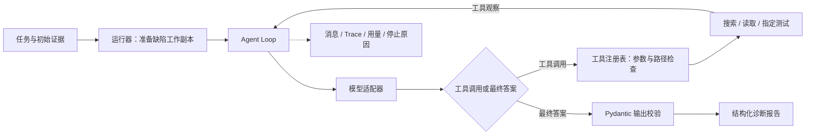

# RepoPilot · 通用仓库研发 Agent

RepoPilot 面向由工单驱动的仓库研发：手动接收或自动监听已登记仓库的新 GitHub Issue，在独立 Git worktree 中实现，独立重跑检查，经只读审核 Agent 与有限返工后暂停，人工批准具体提交，再发布草稿 PR。模型内层循环使用 LangChain／LangGraph，当前接入 DeepSeek。

核心不依赖 Python AST 或 pytest；UTF-8 文件工具与操作者登记的命令支持不同语言仓库。已验证范围及实际运行结果见[真实交付验证](docs/runtime-v2/VALIDATION-05.md)，完整协议见[运行时说明](docs/runtime-v2/README.md)，可按[演示步骤](docs/runtime-v2/DEMO.md)查看真实工单到草稿 PR 的证据。历史 Python 诊断入口和题集仍保留，其结果不代表新运行时的修复效果。

## 安装与配置

准备 Python 3.12 和 Git；JavaScript 示例另需 Node.js。

```powershell
python -m venv .venv
.\.venv\Scripts\python.exe -m pip install -c constraints.txt -e ".[test]"
# 已有 .env 时保留内容
if (-not (Test-Path .env)) { Copy-Item .env.example .env }
```

在 `.env` 中填写 `DS_API_KEY`；默认 `DS_BASE_URL=https://api.deepseek.com`、`DS_MODEL=deepseek-flash`、`DS_THINKING=enabled`、`DS_REASONING_EFFORT=low`。旧运行保持冻结配置；新交付演示使用思考模式，SDK 接线保留其工具调用所需字段，但不记录或展示原始思考文本。GitHub 功能另需 `GITHUB_TOKEN` 或 `GH_TOKEN`，权限按目标仓库配置：读取仓库及 Issue、发布分支需要 Contents 写入、创建 PR 需要 Pull requests 写入；只有创建演示 Issue 时才需 Issues 写入。进程环境变量优先。

## 运行与审批

以下运行命令调用真实模型并产生费用。任务 YAML 声明可信仓库路径、需求和命名检查；路径相对 YAML，命令是参数数组，`{python}` 使用当前解释器。Issue 只提供需求，不能修改本地登记的命令或仓库路径。

```powershell
# 本地任务；兼容不写 run 的旧命令
.\.venv\Scripts\repopilot.exe run examples/runtime/javascript-implement.yaml
# GitHub Issue；--task 指向你本机接入的仓库和检查模板
.\.venv\Scripts\repopilot.exe issue https://github.com/OWNER/REPO/issues/1 --task task.yaml
# 在阶段完成后主动暂停，另一个进程继续
.\.venv\Scripts\repopilot.exe run task.yaml --stop-after implement
.\.venv\Scripts\repopilot.exe jobs
.\.venv\Scripts\repopilot.exe status RUN_ID
.\.venv\Scripts\repopilot.exe resume RUN_ID
# 查看差异、检查证据和审核意见后，批准完整 SHA；批准本身不推送
.\.venv\Scripts\repopilot.exe approve RUN_ID --commit FULL_SHA --reason "已核对差异与检查"
.\.venv\Scripts\repopilot.exe publish RUN_ID
# 也可以拒绝
.\.venv\Scripts\repopilot.exe reject RUN_ID --commit FULL_SHA --reason "需求尚未满足"
```

默认启用工作区和审核，审核通过后的状态是 `awaiting_approval`。只有批准绑定版本才能发布 GitHub 草稿 PR；不会自动合并或发布软件。同一 Issue 重复接入返回已有运行；Issue 内容变化、原始仓库远端不符、审批后版本变化均拒绝发布。失败后可显式 `retry RUN_ID --reason "原因"` 新开一次尝试，旧运行完整保留；同一 Issue 的普通接入始终指向最新尝试。Issue 内容变化不能靠 retry 静默覆盖。

`--no-review` 只做实现；`--no-workspace` 直接只读原目录、禁用编辑，适合无 Git 的快照。这两种运行不能进入 PR 交付。`--max-rework N` 限定返工次数（默认 3，上限 5）。`completed` 仅表示报告流程完成，需同时核对报告结论，不能当作已修复或已交付。

进程在阶段内部退出时，`resume` 会返回 `recovery_required`，不会盲目重放模型或检查。核对现场后可用 `recover RUN_ID --commit FULL_SHA --reason "现场核对结论"` 接纳当前工作树，再 `resume` 从该阶段重新开始。恢复不逐条重建模型对话；已完成阶段无需重新调用模型，累计用量、编辑次数、返工次数和预算保留。发布中断则直接重试 `publish`，先核对远端副作用。

## 自动监听与真实演示

已有真实结果：[zhixianji-jobs Issue #1](https://github.com/saikaji0314/zhixianji-jobs/issues/1) 经实现、104 项独立检查、两轮审核和一次返工，再由用户批准具体提交后创建[草稿 PR #2](https://github.com/saikaji0314/zhixianji-jobs/pull/2)，未合并。[Issue #3](https://github.com/saikaji0314/zhixianji-jobs/issues/3) 则由常驻监听自动接单并完成，93 项检查通过，停在人工审批。

```powershell
# 先复制并修改 watch.example.yaml，登记可信本机仓库、检查和接单标签
.\.venv\Scripts\repopilot.exe watch --config .local/watch.yaml
.\.venv\Scripts\repopilot.exe watch --status
.\.venv\Scripts\repopilot.exe watch --stop
# 手动接入可使用与成功功能演示一致的执行参数
.\.venv\Scripts\repopilot.exe issue ISSUE_URL --task task.yaml --profile examples/runtime/deepseek-delivery.yaml
```

监听器按仓库和标签准入，SQLite 去重后交给有上限的 worker 进程池，每个任务独立 worktree。默认每 60 秒轮询、一个 worker、同仓库一次一个任务；审批等待不占 worker，失败不自动无限重试。停止后等待当前任务落盘；没有安装系统服务或开机自启。参数与恢复边界见[监听说明](docs/runtime-v2/WATCH.md)。

这两条工单是开发复测，不能代表通用成功率。前期非思考模式的过度调查、接线失败与费用记录均保留；当前仍需人审，模型审核可能遗漏问题。[验证记录](docs/runtime-v2/VALIDATION-05.md)区分真实 GitHub／模型结果和模拟测试。

## 证据与限制

运行数据保存在被忽略的 `.local/runtime/`：`jobs.sqlite3` 是任务状态与审批记录，`budget.sqlite3` 是既有累计预算账本，`locks/` 防止同一任务并行写入，`worktrees/<id>/` 保留工作区，`runs/<id>/` 保存本地证据。

| 产物 | 内容 |
| --- | --- |
| `input.json` / `events.jsonl` | 冻结输入、配置版本与模型／工具事件 |
| `report.json` / `changes.json` | 实现结论、相对基线的差异与文件统计 |
| `verification.json` | 编排层独立执行全部登记检查的真实退出码与输出尾部 |
| `review.json` / `review-history.json` | 只读审核结论、逐轮提交与 findings |
| `summary.json` | 最近一次运行或恢复的摘要、用量与原仓库内容是否变化；发布后的最新状态以 `status` 为准 |

审核对象绑定提交。独立检查失败、超时或缺少登记检查时，即使模型批准也不能通过；检查及审核前后工作树必须保持该版本干净。人工批准绑定需求、Issue、提交、审核及验证结果的摘要；发布前再次核对。工作区提交使用单次命令的 Git 身份，不改写原仓库共享配置。

上下文增长时，框架按字节阈值清理较早的读取结果并保留近期内容、工具配对、编辑和检查证据；完整输出仍留在事件中。这不是语义总结，可能需要重新读取文件。

默认每次运行最多 36 次模型请求、40 次工具调用、12 次编辑、3 次返工、300 秒活跃执行时间，估算费用上限 2 元；累计窗口默认 200 元。可在启动或显式 retry 时用 `--profile` 或 `--max-context-bytes`、`--max-tool-calls`、`--max-run-cost-cny` 调整限额，resume 保持原配置。公开的交付 profile 为 48 次模型、80 次工具、24 次编辑、8192 输出 tokens、900 秒和单次 8 元；现有累计账本仍为硬边界。不清零既有账本；失败或用量不明仍保留费用预留。暂停等待不消耗活跃执行期限。费用是保守估算，实付以供应商账单为准。

只用于预先接入的可信仓库。本机检查以当前用户权限运行；路径限制、worktree 和环境变量清理不提供操作系统沙箱。工具拒绝 `.env*`、`.git`、`.local`、数据目录及链接等路径，但宿主进程和仓库代码仍有本机权限。远程 tracing 默认关闭；原始输入、差异及日志只留本机，不随 Git 分发。发布使用 GitHub REST 和 Git，不要求安装 `gh`。

## 历史 Python 诊断入口

旧入口根据缺陷描述与初始日志，调查 Python 仓库、运行指定 pytest，输出根因、证据、修改建议与验证方案。旧技术栈为原生 Tool Calling、百炼 Qwen、Python AST 和 pytest。

## 一个典型场景

用户报告“文章作者编辑时收到 403，其他用户却能访问”。Agent 通过工具调查鉴权实现与测试，关联作者 ID 比较条件和两种用户行为，给出代码位置、修改建议及正反权限验证方案。

最终输出包含 `status`、`summary`、`root_cause`、`evidence`、`proposed_fix`、`verification`、`risks`。每次运行保留模型消息、工具结果和停止原因，可以核对答案依据，也能追查失败发生在哪一步。旧入口提供只读诊断与测试执行，修改建议由用户审阅后实施；需要直接改动文件时可改用上文的独立工作区流程。

## 架构与执行链路



运行器负责基线预检、缺陷注入、环境选择与工具装配；Loop 负责消息循环、预算和停止条件；模型适配器隔离 SDK；检索模块负责符号索引和证据片段；评测端独立持有 Oracle。这样的边界使循环逻辑能够用 Fake 模型测试，检索算法也可以脱离模型 SDK 验证。

## 关键工程设计

| 设计 | 实现与取舍 | 代码入口 |
| --- | --- | --- |
| 显式 Agent Loop | 使用原生 `tools` / `tool_calls`，管理多轮消息与工具结果配对 | [loop.py](repopilot/agent/loop.py) |
| 受控工具执行 | 统一工具协议、Pydantic 参数校验、工作区路径检查、指定 pytest 目标 | [工具注册表](repopilot/tools/base.py)、[路径检查](repopilot/tools/path_guard.py) |
| 有限错误恢复 | 对允许的工具与错误组合提供一次纠错轮次；最终答案校验失败后提供一次无工具格式恢复，计入原预算 | [Loop 异常路径](repopilot/agent/loop.py) |
| 可配置资源限制 | 限制模型轮数、工具次数、累计 Token、估算费用及执行时间 | [agent.yaml](configs/agent.yaml) |
| 轻量代码检索 | AST 提取函数与类位置，按名称和路径排序；结果去重并按字符预算选择片段 | [retrieval](repopilot/retrieval/index.py) |
| 可追踪与可比较 | 保存实际工具定义、初始消息、配置和任务哈希；对照脚本固定任务并交替执行两组方案 | [运行器](repopilot/agent_runner.py)、[对照脚本](scripts/compare_retrieval.py) |

工具包括 `list_files`、`read_file`、`search_code`、`run_test`，以及可选的 `search_symbols`。字面搜索用于变量、配置键与调用位置，符号检索用于已知函数或类的定义定位。索引在缺陷工作副本准备后构建，避免读取干净版本；通过 AST 解析源码，无需导入被分析模块。

## 评测结果与发现

题集包含 10 条受控缺陷任务，覆盖 Flaskr 鉴权、密码校验、输入边界、排序、事务、配置，跨文件工单筛选与缓存，以及 Flask 框架的 Blueprint 与 Session 行为。每题分离 Agent 输入与评测答案；严格通过要求达到评分线且满足全部硬条件。

| 实验 | 样本 | 严格通过 | 估算模型费用 |
| --- | --- | --- | ---: |
| 单次 LLM 全文基线 | 6 题 × 2 次 | 8/12 | ¥0.379332 |
| 只读 Agent 六题批次 | 6 题 × 1 次 | 4/6 | ¥0.409940 |
| 四工具检索方案 | 10 题 × 1 次 | 5/10 | ¥0.984730 |
| 五工具检索方案 | 10 题 × 1 次 | 4/10 | ¥1.202716 |

前两项用于观察全文输入与主动调查的行为，样本和配置不同，不能直接推导效果提升。后两项使用固定模型、任务和预算进行方案对照；新增符号工具自然被使用的任务为 2/10，本次初筛尚未证明端到端收益。

对照实验还暴露了两类主要瓶颈：获得相关代码后仍缺少完整调用链或副作用验证，以及最终输出协议失败。项目将证据命中、合法答案和严格诊断通过分别记录，后续优化据此判断应调整检索、收尾策略还是协议处理。每题每组一次的结果不支持统计显著性结论。

详细评分与失败案例：[基线报告](evals/reports/baseline-v1.md) · [六题 Agent 报告](evals/reports/agent-v2.md) · [检索对照报告](evals/reports/retrieval-comparison-v1.md)。费用按配置单价估算；原始模型日志未随仓库分发，重新运行可生成轨迹。本题集为受控构造任务。

## 本地运行

准备 Python 3.12、Git，在仓库根目录使用 PowerShell：

```powershell
python -m venv .venv
.\.venv\Scripts\python.exe -m pip install -e .
.\.venv\Scripts\python.exe -m pytest -q
Copy-Item .env.example .env
```

在 `.env` 中配置 `DASHSCOPE_API_KEY` 和 `DASHSCOPE_WORKSPACE_ID`（当前配置校验要求两项均填写）。模型与预算在 `configs/agent.yaml` 配置。运行一条诊断任务（会调用模型并产生费用）：

```powershell
.\.venv\Scripts\python.exe -m scripts.run_agent --task flaskr-auth-001 --repetitions 1
```

结果保存到 `evals/runs/agent/<batch>/<task>/run-01/`：

| 文件 | 内容 |
| --- | --- |
| `final_answer.json` | 通过输出协议校验的诊断；失败时可能不存在 |
| `summary.json` | 运行终态、用量、耗时及停止原因 |
| `messages.json` / `trace.jsonl` | 模型消息和逐步事件记录 |
| `runtime.json` / `task.json` | 实际配置、工具定义及可见任务快照 |

比较检索方案：

```powershell
.\.venv\Scripts\python.exe -m scripts.run_agent --task flaskr-auth-001 --repetitions 1 --retrieval-mode code
.\.venv\Scripts\python.exe -m scripts.run_agent --task flaskr-auth-001 --repetitions 1 --retrieval-mode symbols
```

运行 Flask 源码任务 009/010 或完整十题对照前，需准备独立环境：

```powershell
.\.venv\Scripts\python.exe -m venv .venv-flask-source
.\.venv-flask-source\Scripts\python.exe -m pip install -r configs/flask-source-test-requirements.txt
.\.venv\Scripts\python.exe -m scripts.verify_flask_source_tasks
```

全题对照命令为 `python -m scripts.compare_retrieval`，会产生多次模型调用；指标采集后的严格评分需要按 Oracle 审核。更多说明见 [评测复现](docs/phase-2/EVALUATION.md)。自动化测试主要使用 Fake/Mock 模型，缺少独立环境或系统条件时部分测试会跳过。

## 代码与文档导航

```text
repopilot/agent/       模型适配、循环协议与 Trace
repopilot/tools/       工具注册、参数模型与执行边界
repopilot/retrieval/   AST 索引、排序与上下文片段
scripts/              运行、预检与对照入口
evals/tasks/          任务输入、缺陷补丁和评测 Oracle
evals/reports/        已归档的评测结果与失败分析
target-repos/         固定版本的被测仓库
tests/                循环、工具、检索及题集回归测试
```

- [任务建模与基线](docs/phase-0/README.md)
- [Agent 执行引擎](docs/phase-1/README.md)
- [代码检索与上下文](docs/phase-2/README.md)
- [评测任务说明](evals/tasks/README.md)
- [被测仓库与来源](target-repos/README.md)

## 扩展方向

自动合并、软件发布、操作系统沙箱、跨机器恢复和长期部署仍是后续范围。首版支持人工触发与常驻监听、受控本机执行和审批后草稿 PR。历史诊断通过率与新运行时实现效果分别记录。

Flask 源码与教程样例来自 Pallets，保留其上游 README 和 BSD-3-Clause 许可证。
