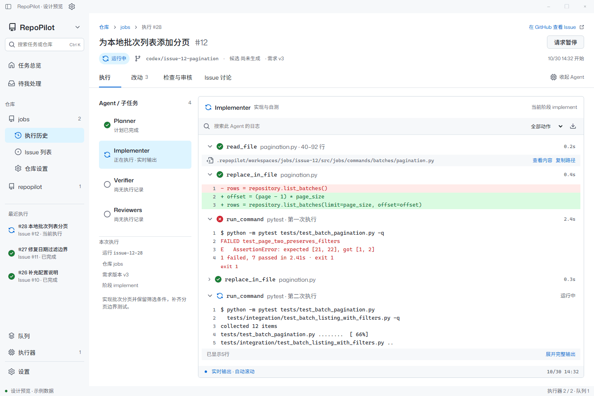
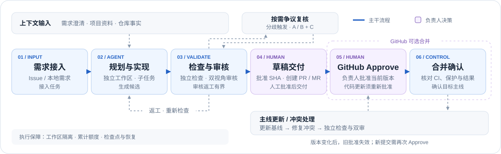

<div align="center">
  <a href="https://github.com/saikaji0314/repopilot">
    <picture>
      <source media="(prefers-color-scheme: dark)" srcset="assets/logo-dark.svg">
      
    </picture>
  </a>
  <h3>面向代码仓库的受控研发 Agent</h3>
  <p>从 Issue 实现、检查与审核，到负责人批准后的 PR 交付和合并。</p>
  <p>
    <a href="LICENSE"></a>
    <a href="docs/runtime-v2/INSTALL.md"></a>
    <a href="https://github.com/langchain-ai/langchain"></a>
    <a href="https://github.com/langchain-ai/langgraph"></a>
    <a href="https://github.com/saikaji0314/repopilot/stargazers"></a>
  </p>
  <p>
    <a href="#桌面预览">桌面预览</a> ·
    <a href="#核心特性">核心特性</a> ·
    <a href="#工作流程">工作流程</a> ·
    <a href="#快速开始">快速开始</a> ·
    <a href="docs/README.md">文档</a>
  </p>
</div>

## 项目简介

RepoPilot 将代码实现、验证、审核和交付组织成可追溯的研发流程。它接收 GitHub／GitLab Issue 或本地需求，在独立工作区修改代码，由程序重跑登记检查，并让两个只读审核视角核对同一提交。负责人批准后，发布草稿 PR／MR；GitHub 还可启用原生 Approve 后的自动合并与结果确认。

项目面向可信仓库中的明确开发任务，帮助维护者把精力集中在需求、业务取舍和最终审批上，同时保留每次改动的检查依据、审核意见与交付记录。

## 桌面预览

查看 Agent 执行动作、命令输出与代码改动，核对候选审核，并在桌面配置自己的 GitHub 机器人。



动图使用示例数据展示桌面界面。[下载 Windows 桌面版](https://github.com/saikaji0314/repopilot/releases/download/v0.2.0rc1/RepoPilot-Setup-0.2.0-rc.1-x64.exe) · [演示说明](docs/demo/README.md)

## 核心特性

| 能力 | 说明 |
| --- | --- |
| 桌面工作台 | 执行详情、日志、改动与审核集中展示；可调整分栏、配置机器人并参与 Issue 讨论 |
| 任务规划与协作 | 按需澄清、拆分子任务；支持独立工作区并行执行和统一整合 |
| 独立验证与双审 | 程序重跑登记检查，正确性与需求上下文分别审核，支持有限返工和争议复核 |
| 明确的审批边界 | 草稿发布绑定固定提交；GitHub 合并另需负责人对当前版本的原生 Approve |
| 基线更新与冲突处理 | 合入主线变化，必要时修复冲突，重新检查和审核后等待新版本批准 |
| 可恢复的受控执行 | 保存检查点与累计用量，支持显式恢复、额度限制和可选 Docker 执行 |
| 可追溯的项目上下文 | 项目资料、决定与仓库事实带来源和版本；离线报告集中呈现交付证据 |

## 工作流程

<picture>
  <source media="(prefers-color-scheme: dark)" srcset="assets/workflow-dark.svg">
  
</picture>

默认交付到草稿 PR／MR；后续自动合并为 GitHub 可选能力。创建草稿与合并是两次独立决定，代码更新后需要重新验证，并取得负责人对新提交的批准。[合并与审批规则 →](docs/runtime-v2/MERGING.md)

## 快速开始

### Windows 桌面预发行

**[下载 Windows x64 安装程序（.exe）](https://github.com/saikaji0314/repopilot/releases/download/v0.2.0rc1/RepoPilot-Setup-0.2.0-rc.1-x64.exe)** · [v0.2.0rc1 Release 与校验文件](https://github.com/saikaji0314/repopilot/releases/tag/v0.2.0rc1)

内置本机服务，打开桌面无需另装 Python 或 Node.js。当前支持执行详情、可调分栏、加密连接配置与普通评论；完整桌面执行入口仍在开发。[安装与限制](docs/desktop/RELEASE-0.2.0rc1.md) · [配置自己的机器人](docs/desktop/SETUP.md)

### 环境要求

Python 3.11+、Git 和模型 API 密钥。下方 JavaScript 示例另需 Node.js。默认在本机执行检查，仅接入可信仓库；Docker 可选。[完整安装指南](docs/runtime-v2/INSTALL.md)

### 安装与配置

以下为当前 `dev` 开发版的 PowerShell 示例：

```powershell
git clone --branch dev https://github.com/saikaji0314/repopilot.git
cd repopilot
python -m venv .venv
.\.venv\Scripts\python.exe -m pip install -c constraints.txt -e .
if (-not (Test-Path .env)) { Copy-Item .env.example .env }
```

在本机 `.env` 中填写 `DS_API_KEY`。其他供应商和运行限额见[模型配置](docs/runtime-v2/MODELS.md)。

### 运行本地任务

为示例准备 Git 基线，然后执行任务并导出报告。`run` 会调用真实模型；密钥只保存在本机，不应提交到 Git。

```powershell
$demo = "examples/runtime/fixtures/javascript"
git -C $demo init -q
git -C $demo add .
git -C $demo -c user.name=RepoPilot -c user.email=demo@example.test commit -m "demo baseline"
.\.venv\Scripts\repopilot.exe run examples/runtime/javascript-implement.yaml
# 将 RUN_ID 替换为任务输出的运行 ID
.\.venv\Scripts\repopilot.exe report RUN_ID --html .local/demo/report.html
```

打开生成的 HTML 查看改动、检查、审核及当前等待事项。接入自己的仓库时，用任务 YAML 登记需求、仓库路径和检查命令。[任务格式与 CLI](docs/runtime-v2/README.md)

### GitHub 集成

按[GitHub App 指南](docs/runtime-v2/GITHUB-APP.md)配置机器人，并通过[平台接入](docs/runtime-v2/FORGES.md)或[监听队列](docs/runtime-v2/WATCH.md)接收 Issue。负责人批准候选提交后创建草稿 PR；启用自动合并时，负责人在 GitHub 提交 Approve，程序核对 CI、分支保护和版本，再合并并确认结果。

## 文档

| 主题 | 入口 |
| --- | --- |
| 安装、模型与任务配置 | [安装指南](docs/runtime-v2/INSTALL.md) · [模型配置](docs/runtime-v2/MODELS.md) · [运行协议](docs/runtime-v2/README.md) |
| Issue 接入与交付 | [托管平台](docs/runtime-v2/FORGES.md) · [GitHub App](docs/runtime-v2/GITHUB-APP.md) · [合并策略](docs/runtime-v2/MERGING.md) |
| 规划、并行与审核 | [任务规划](docs/runtime-v2/PLANNING.md) · [并行整合](docs/runtime-v2/PARALLEL.md) · [审核机制](docs/runtime-v2/REVIEW.md) |
| 执行隔离与项目上下文 | [Docker](docs/runtime-v2/SANDBOX.md) · [项目资料](docs/runtime-v2/KNOWLEDGE.md) · [事实记忆](docs/runtime-v2/MEMORY.md) |
| 架构、验证与版本 | [架构设计](docs/runtime-v2/ARCHITECTURE.md) · [验证总览](docs/VALIDATION.md) · [版本沿革](CHANGELOG.md) |

完整索引见[文档导航](docs/README.md)。

## 开发与贡献

欢迎通过 Issue 描述问题或提交 PR。新增行为应附可复现的验证，接口与配置变化应同步文档。使用现有虚拟环境运行离线回归：

```powershell
.\.venv\Scripts\python.exe -m pytest -q -p no:cacheprovider
```

Docker 与独立环境用例按环境条件运行；测试范围与复现方法见[验证总览](docs/VALIDATION.md)。

## 项目状态

Windows 桌面版已发布预发行版本，任务启动、自动接单和运行中协作将继续完善。CLI 与桌面的能力范围、后续开发方向见[路线图](docs/ROADMAP.md)；已有交付案例见[演示记录](docs/runtime-v2/DEMO.md)。

## 许可证

RepoPilot 自有代码采用 [MIT](LICENSE)。Flask 源码与教程样例来自 Pallets，保留其 BSD-3-Clause 许可证；第三方材料保留原有许可。
