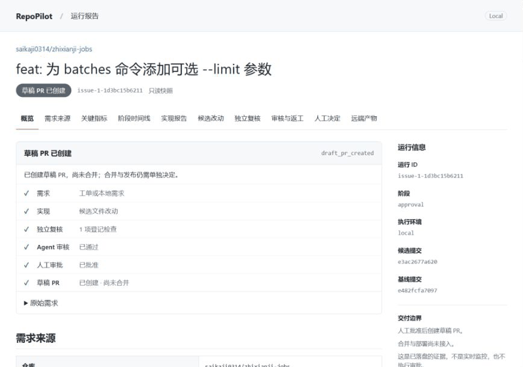

<div align="center">
  <a href="https://github.com/saikaji0314/repopilot">
    <picture>
      <source media="(prefers-color-scheme: dark)" srcset="assets/logo-dark.svg">
      <source media="(prefers-color-scheme: light)" srcset="assets/logo-light.svg">
      
    </picture>
  </a>
  <h3>从 Issue 到可审核的草稿 PR。</h3>
  <p>面向可信代码仓库的开源研发 Agent，保留改动、检查与审批证据。</p>
  <p>
    <a href="LICENSE"></a>
    <a href="docs/runtime-v2/INSTALL.md"></a>
    <a href="https://github.com/langchain-ai/langchain"></a>
    <a href="https://github.com/langchain-ai/langgraph"></a>
    <a href="https://github.com/saikaji0314/repopilot/stargazers"></a>
  </p>
  <p>
    <a href="#快速开始">快速开始</a> ·
    <a href="docs/runtime-v2/DEMO.md">交付演示</a> ·
    <a href="docs/runtime-v2/README.md">使用文档</a> ·
    <a href="docs/runtime-v2/ARCHITECTURE.md">架构设计</a>
  </p>
</div>

## 工作方式

接入 GitHub／GitLab Issue 或本地需求，在独立 worktree 中实现、自检并接受审核返工。人工批准具体提交后，推送分支并创建草稿 PR／MR；GitHub可按运行启用[负责人原生Approve后的受控合并](docs/runtime-v2/MERGING.md)，可更新PR基线并解决冲突，重新检查、双审和批准后核对远端结果。支持[GitHub App机器人身份](docs/runtime-v2/GITHUB-APP.md)，软件发布与部署由维护者决定。

`Issue → worktree → 实现 → 独立检查 → 审核／返工 → 人工批准 → 草稿 PR`

- **独立验证**：编排层重跑登记检查，审核绑定固定提交，人工审批绑定完整 SHA。
- **双视角审核**：正确性与需求上下文两个只读视角并行审同一固定提交与依据；发现合并保留来源，具体争议才启动 A／B＋C，最多三次修改后交人。
- **默认先规划**：新任务先整理任务说明与顺序子任务，集中提问最多 3 批；`--no-plan`保留小任务单Agent路径。依赖有环或缺前置产物不执行，子Issue按需映射。
- **受控并行**：可并行计划最多2个全局实现槽位，每个子任务独立worktree；单Agent、顺序子任务、返工和整合修复共用同一上限；结果串行整合到父临时分支，再对组合代码独立检查，不直接更新main。
- **可恢复执行**：SQLite 保存阶段状态与累计预算，支持暂停、显式恢复及轮询接单。
- **可选 Docker 隔离**：文件工具与检查禁网执行、限制资源，校验产物后导入；失败不回退宿主。
- **可追溯记忆**：可选文件事实书签，带提交来源、文件指纹和人工确认，变更后失效。
- **离线交接报告**：集中查看差异、检查、审核、费用、审批和 PR，不依赖前端服务。

## 看一条真实交付

[Issue #1](https://github.com/saikaji0314/zhixianji-jobs/issues/1) → 104 项独立检查 → 两轮审核、一次返工 → 人工批准 → [草稿 PR #2](https://github.com/saikaji0314/zhixianji-jobs/pull/2)（未合并）。

新流程另已跑通[Issue #4](https://github.com/saikaji0314/zhixianji-jobs/issues/4)：默认规划、100项离线检查、独立JSON验收、两个真实审核视角，负责人批准固定SHA后创建[草稿PR #5](https://github.com/saikaji0314/zhixianji-jobs/pull/5)。[本轮验证及失败边界 →](docs/runtime-v2/VALIDATION-30.md)



动图为真实历史运行的只读回放。[查看交付证据与失败记录 →](docs/runtime-v2/VALIDATION-05.md)

## 快速开始

以下为源码安装的 PowerShell 示例，需要 Python 3.12、Git、Node.js 和模型 API。Docker 可选；默认本机执行，仅接入可信仓库。

```powershell
git clone https://github.com/saikaji0314/repopilot.git
cd repopilot
python -m venv .venv
.\.venv\Scripts\python.exe -m pip install -c constraints.txt -e .
if (-not (Test-Path .env)) { Copy-Item .env.example .env }
```

在 `.env` 填写 `DS_API_KEY`，准备示例的 Git 基线，再运行一项小任务：

```powershell
$demo = "examples/runtime/fixtures/javascript"
git -C $demo init -q
git -C $demo add .
git -C $demo -c user.name=RepoPilot -c user.email=demo@example.test commit -m "demo baseline"
# 调用真实模型，会产生 API 费用
.\.venv\Scripts\repopilot.exe run examples/runtime/javascript-implement.yaml
# 将 RUN_ID 替换为运行输出中的 ID
.\.venv\Scripts\repopilot.exe report RUN_ID --html .local/demo/report.html
```

接入自己的仓库时，在任务 YAML 中登记需求、路径和检查命令。工具不限制代码语言，构建依赖与验收环境需自行准备。[安装、配置与升级 →](docs/runtime-v2/INSTALL.md)

## 文档

| 我想…… | 入口 |
| --- | --- |
| 接 Issue、审批、创建草稿 PR／MR | [平台接入](docs/runtime-v2/FORGES.md) · [自动监听](docs/runtime-v2/WATCH.md) |
| GitHub负责人Approve后自动合并 | [合并策略、轮询与结果确认](docs/runtime-v2/MERGING.md) |
| 配置模型、限额或恢复任务 | [模型](docs/runtime-v2/MODELS.md) · [运行协议](docs/runtime-v2/README.md) |
| 按需规划、集中提问或映射子Issue | [计划与提问](docs/runtime-v2/PLANNING.md) · [人工协作](docs/runtime-v2/HUMAN.md) |
| 双视角审核、争议复核或修改上限 | [双审与争议](docs/runtime-v2/REVIEW.md) |
| 并行实现、独立worktree或内部整合 | [并行与整合](docs/runtime-v2/PARALLEL.md) |
| 配置隔离执行、代码记忆或项目资料 | [Docker](docs/runtime-v2/SANDBOX.md) · [Memory](docs/runtime-v2/MEMORY.md) · [项目资料](docs/runtime-v2/KNOWLEDGE.md) |
| 理解实现与技术取舍 | [架构与代码导航](docs/runtime-v2/ARCHITECTURE.md) · [设计](docs/runtime-v2/DESIGN.md) |
| 查看评测与安装候选 | [评测方法与结果](evals/swebench/README.md) · [0.1.0rc1](docs/runtime-v2/RELEASE-0.1.0rc1.md) |

## 当前边界

当前为实验性候选，适合可信仓库中的明确小任务。GitHub已验证默认规划、真实双视角审核到负责人批准固定提交后的草稿交付；这是小样本开发验证。GitLab、Qwen／兼容接口与Claude仅完成离线适配验证。评论自动往返、子Issue映射、真实模型并行与A／B＋C争议判断仍没有完整真实效果结论。Docker已验证真实容器机制，该后端的真实模型交付及本轮其他仓库结果以[增量30](docs/runtime-v2/VALIDATION-30.md)逐项记录为准；不提供microVM级隔离。

评测协议、逐题结果和记忆收益对照见评测文档；开发样本不代表通用修复率。

## 许可证

RepoPilot 自有代码采用 [MIT](LICENSE)。Flask 源码与教程样例来自 Pallets，保留其 BSD-3-Clause 许可证；第三方材料保留原有许可。
