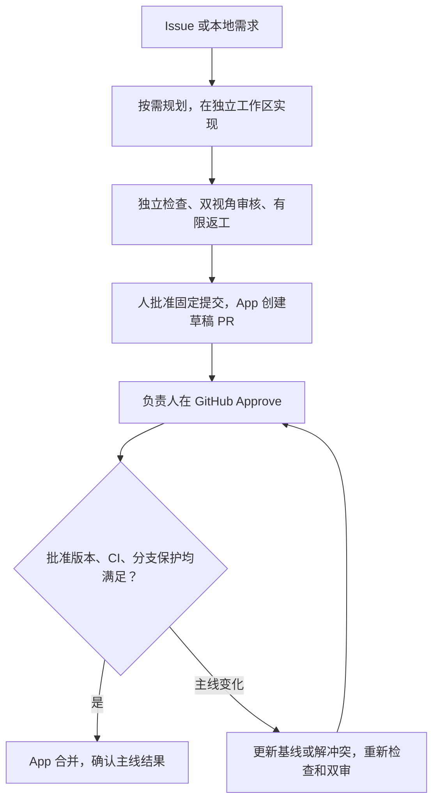

<div align="center">
  <picture>
    <source media="(prefers-color-scheme: dark)" srcset="assets/logo-dark.svg">
    
  </picture>
  <h3>把 Issue 做成可检查、可批准的代码改动。</h3>
  <p>Agent 实现、测试和提 PR；负责人批准后，Agent 合并并确认结果。</p>
  <p><a href="LICENSE">MIT</a> · Python 3.11+ · <a href="docs/README.md">使用文档</a> · <a href="docs/VALIDATION.md">真实验证与限制</a></p>
</div>

## RepoPilot 做什么

给它一个 GitHub／GitLab Issue，或一份本地需求。RepoPilot 在独立的 Git 工作副本中修改代码，运行你登记的检查，再让两个只读审核视角检查同一个提交。检查和审核通过后，它暂停，等待负责人批准具体提交，再创建草稿 PR／MR。

GitHub 还可启用后续合并：App 机器人负责提交 PR，你在 GitHub 转为 Ready for review 并点 Approve。RepoPilot 核对批准、CI 和分支保护，然后合并并确认主线确实包含结果。如果主线先发生变化，它可以更新 PR、处理冲突、重新检查和双审，再等你批准新提交。

适合已有 Git 仓库、能明确说明需求和验证方法的小型研发任务。你需要准备依赖和检查环境，并对业务取舍与最终批准负责。



这里有两次不同决定：批准创建草稿，允许推送这份代码；GitHub Approve，允许合并当前 PR 版本。代码更新后，旧批准不能放行新代码。[完整规则 →](docs/runtime-v2/MERGING.md)

## 看一次真实交付

[批次列表分页 Issue #6](https://github.com/saikaji0314/zhixianji-jobs/issues/6) → 规划与实现 → 104项测试和独立黑盒验收 → 双审发现文档问题并返工一次 → 人工批准固定提交 → [App 作者的 PR #7](https://github.com/saikaji0314/zhixianji-jobs/pull/7) → 负责人原生 Approve → App 自动合并并确认。

成功尝试用了72次模型请求、111次工具执行，估算4.79元。此前失败的规划尝试用了约2.92元，保留在验证记录中，两次合计约7.71元。这是一个开发样本，不能据此推算任意任务的价格或成功率。


另以[帮助任务PR #9](https://github.com/saikaji0314/zhixianji-jobs/pull/9)验证了真实冲突：第一次Approve后主线修改同一行，Agent保留双方要求、重跑107项测试与独立验收、重新双审，旧Approve撤销；负责人批准新提交后，App合并并确认。整轮56次模型请求、估算2.78元；保留两条非阻断的文档计数建议。[详细证据](docs/VALIDATION.md#帮助任务的真实冲突验证)

动图是已经结束的真实运行的只读回放，不是实时终端录像。[证据与失败记录](docs/VALIDATION.md) · [展示来源与生成方法](docs/demo/README.md)

## 快速开始

以下安装当前 `dev` 开发版，尚未发布新版本。需要 Python 3.11+、Git和模型API密钥；下面的JavaScript示例还需要Node.js。默认在本机执行检查，仅接入可信仓库；[Docker执行](docs/runtime-v2/SANDBOX.md)可选。

在PowerShell中执行：

```powershell
git clone --branch dev https://github.com/saikaji0314/repopilot.git
cd repopilot
python -m venv .venv
.\.venv\Scripts\python.exe -m pip install -c constraints.txt -e .
if (-not (Test-Path .env)) { Copy-Item .env.example .env }
```

在本机`.env`中填写`DS_API_KEY`，然后准备示例的Git基线并运行。不要把密钥提交到Git。

```powershell
$demo = "examples/runtime/fixtures/javascript"
git -C $demo init -q
git -C $demo add .
git -C $demo -c user.name=RepoPilot -c user.email=demo@example.test commit -m "demo baseline"
# 下一条会调用真实模型并产生 API 费用
.\.venv\Scripts\repopilot.exe run examples/runtime/javascript-implement.yaml
# RUN_ID 替换为上一条输出的运行 ID
.\.venv\Scripts\repopilot.exe report RUN_ID --html .local/demo/report.html
```

打开生成的HTML，可以查看改动、检查、审核、用量和当前等待事项。接入自己的仓库时，在任务YAML中登记需求、仓库路径和检查命令；模型只能选择这些已登记的检查。[安装与配置](docs/runtime-v2/INSTALL.md) · [任务格式与命令](docs/runtime-v2/README.md)

## 接入 GitHub

1. 按[GitHub App指南](docs/runtime-v2/GITHUB-APP.md)配置机器人，只安装到需要的仓库。
2. 按[平台接入指南](docs/runtime-v2/FORGES.md)接入Issue，或配置[监听队列](docs/runtime-v2/WATCH.md)。
3. 审阅候选报告，批准完整提交SHA，再创建草稿PR。回答问题不等于批准发布。
4. 如需自动合并，按[合并指南](docs/runtime-v2/MERGING.md)设置负责人、必需CI和分支保护，并运行前台检测。你在GitHub提交Approve，程序核对条件后执行。

每次运行分别限制模型请求、工具执行、时间和估算费用；等待人工时不调用模型。暂停或重启不会清零累计额度，也不会自动加额。[模型与限额](docs/runtime-v2/MODELS.md)

## 更多能力与边界

- [规划与集中提问](docs/runtime-v2/PLANNING.md)：按需拆任务，小任务可用`--no-plan`。
- [独立工作区并行](docs/runtime-v2/PARALLEL.md)：最多两个实现槽位，组合代码仍需统一检查和审核。
- [双审与争议处理](docs/runtime-v2/REVIEW.md)：常规两个视角独立核对；确有争议时才进入额外复核。
- [项目资料](docs/runtime-v2/KNOWLEDGE.md)与[仓库事实记忆](docs/runtime-v2/MEMORY.md)：带来源和版本，代码改变后核对失效，不能复用旧批准。
- [持久化与恢复](docs/runtime-v2/README.md)：保存阶段、现场和累计用量，异常后保留证据。

当前仍是实验性开发版。GitHub、DeepSeek和Docker已有真实交付记录；GitLab、其他模型适配、真实模型并行和争议复核等能力须按[验证总览](docs/VALIDATION.md)区分离线覆盖和真实效果。简单任务通过不证明复杂业务冲突一定能自动解决。软件发行、部署、后台常驻服务和大规模成功率仍需后续工作。

[文档导航](docs/README.md) · [架构与代码入口](docs/runtime-v2/ARCHITECTURE.md) · [版本沿革](CHANGELOG.md) · [后续范围](docs/ROADMAP.md) · [公开评测](evals/swebench/README.md)

## 许可证

RepoPilot自有代码采用[MIT](LICENSE)。Flask源码与教程样例来自Pallets，保留其BSD-3-Clause许可证；第三方材料保留原有许可。
