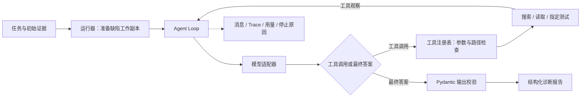

# RepoPilot · 通用仓库研发 Agent

RepoPilot 面向由工单驱动的仓库研发：调查需求、准备工作区、实现、验证、审核并交付可供人审的代码变更。项目正在从 Python 只读诊断工具演进为通用 coding agent，完成范围按增量验收。

新的运行时入口支持语言无关的文本检索、文件读取、命名检查与结构化调查报告，并具备独立工作区内的实现、绑定提交的只读审核、有限返工以及差异与检查证据；使用 LangChain／LangGraph 与 DeepSeek。仍不提供 GitHub PR、断点恢复与人工暂停。原有 Python 诊断入口、题集和历史结果保留，下文历史实验不代表新运行时的修复效果。

## 新运行时：调查与验证

准备 CPython 3.12 和 Git，JavaScript 示例还需要 Node.js 24。PowerShell 中执行：

```powershell
python -m venv .venv
.\.venv\Scripts\python.exe -m pip install -c constraints.txt -e ".[test]"
# 仅首次创建；已有 .env 时保留其内容。
if (-not (Test-Path .env)) { Copy-Item .env.example .env }
```

在 `.env` 配置 `DS_API_KEY`，默认 `DS_BASE_URL=https://api.deepseek.com`、`DS_MODEL=deepseek-flash`。进程环境变量优先于文件。新入口不要求百炼 Workspace ID。以下命令调用真实模型并产生费用：

```powershell
# 只读调查：为原仓库建独立工作区，再用读取类工具调查
.\.venv\Scripts\repopilot.exe examples/runtime/flaskr-inspect-worktree.yaml
# 实现：在独立工作区编辑文件并运行已登记检查
.\.venv\Scripts\repopilot.exe examples/runtime/flaskr-implement.yaml
.\.venv\Scripts\repopilot.exe examples/runtime/javascript-implement.yaml
# 只实现不审核
.\.venv\Scripts\repopilot.exe examples/runtime/javascript-implement.yaml --no-review
# 审核要求返工时最多重做 1 轮（默认 3，上限 5）
.\.venv\Scripts\repopilot.exe examples/runtime/javascript-implement.yaml --max-rework 1
# 旧的只读样例指向不含 .git 的目录，必须跳过工作区
.\.venv\Scripts\repopilot.exe examples/runtime/flaskr-inspect.yaml --no-workspace
.\.venv\Scripts\repopilot.exe examples/runtime/javascript-inspect.yaml --no-workspace
```

任务 YAML 声明仓库路径、需求与验证命令；路径相对于 YAML 文件，命令是参数数组，`{python}` 使用当前虚拟环境解释器。模型只能选择已登记检查，每项检查每次运行最多执行一次。普通 UTF-8 源码无需按语言注册扩展名，Python AST 不是新运行时的前提。

默认先在原仓库之外创建 git worktree 作为独立工作区，编辑只发生在工作区内；原仓库必须含 `.git`，否则本次运行以 `workspace_error` 结束。工作区默认位于 `.local/runtime/worktrees/`，运行结束后保留，便于人工核对改动。编辑工具有两个：`write_file` 写入或覆盖 UTF-8 文本（单文件上限 100,000 字符），`replace_in_file` 做精确字符串替换（找不到或多处匹配都拒绝，不做模糊替换）。读写共用同一套边界：拒绝绝对路径、`..`、盘符、敏感目录（`.git`、`.local`、`.env*`、`node_modules`、`data` 等）与符号链接，写入必须落在工作区内；每次运行编辑次数默认上限 12。`--no-workspace` 跳过工作区：读取类工具直接指向原仓库，不提供编辑工具，适合没有 `.git` 的只读快照。

证据契约区分两类证据：文件证据给出相对路径与起始行号，检查证据给出检查名与真实退出码。报告 `status` 为 `implemented / planned / needs_clarification / blocked`，并有本地事实校正：只有存在文件变更才允许 `implemented`，没有变更会被改写为 `planned`，`implemented` 至少要有一条检查证据。

默认资源限制：每次运行最多 20 次模型请求、40 次普通工具调用，运行期限 300 秒，单次运行估算费用上限 2 元。触及任一限制即停止并保留已有结果。

运行证据与预算账本默认存于被忽略的 `.local/runtime/`，其中 `runs/<id>/` 保存 `input.json`、`events.jsonl`、`summary.json`，成功生成报告时另有 `report.json`，有工作区时另有 `changes.json`，启用审核时另有 `review.json`、`review-history.json` 与 `verification.json`。`completed` 表示报告协议完成，报告中的 `status` 表示本次结论，不代表代码已修好或已合并；检查退出码单独记录。

| 文件 | 内容 |
| --- | --- |
| `changes.json` | 相对基线的变更文件、增删行、统一差异、基线提交与工作区路径 |
| `review.json` | 最近一次审核的 `verdict`、摘要与 findings（文件、起始行号、严重程度、观察与建议） |
| `review-history.json` | 逐轮审核的锚点提交、结论与发现；没有审核轮次时不存在 |
| `verification.json` | 编排层独立重跑登记检查得到的检查名、真实退出码与输出尾部 |
| `summary.json` | 除运行终态、用量与停止原因外，含 `edits`（编辑次数、上限与涉及文件）、`changes`（变更文件数、增删行、基线提交与工作区）与 `repository_unchanged`（原仓库的 git 状态快照是否与运行前一致）；启用审核时含 `review` 块；未建工作区时后两项为 `null` |

`summary.json` 的 `review` 块记录 `review_rounds`（实际进入审核的轮数）、`rework_attempts`（实现 Agent 真正被叫回返工的次数，与审核轮数不必相等）、`reviewed_commit`（最近一次审核锚点提交）、`verdict`、`findings`（发现条数）、`limit`（返工上限）与 `final_commit`。

原始材料（输入、工具事件、报告、差异与摘要）只保存在本机 `.local/runtime/`，不随 Git 分发。

本轮验证范围有限，不能当作通用成功率。离线回归 `python -m pytest -q -rs` 为 272 passed、5 skipped；真实 DeepSeek（`deepseek-flash`）本轮 11 次启用审核的运行中，10 次 `approved`（含一次完整的“审核打回 → 返工 → 再审通过”闭环）、1 次 `rework_limit_reached`、1 次 `review_inconclusive`，每次都记录 `repository_unchanged: true`，审核结论引用了具体文件与行号，还出现过一次实现方声称的检查结果与复核结果冲突的指出。返工闭环用一条分步交付工单触发：实现方只做了一半、`unit` 检查真实失败，审核方给出 finding，返工补齐后第二轮审核通过。合并与 PR、断点恢复、人工暂停、并发运行和非 Git 仓库尚未验证。

本机执行仅用于预先接入的可信仓库，不提供操作系统沙箱。工作区隔离是文件层面的编辑隔离，不是操作系统沙箱：仓库代码与已登记检查仍以当前用户权限执行。资源限制、估算费用与已验证边界见[新运行时需求及验收](docs/runtime-v2/README.md)，验证记录见[增量 1 验证记录](docs/runtime-v2/VALIDATION-01.md)、[增量 2 验证记录](docs/runtime-v2/VALIDATION-02.md)与[增量 3 验证记录](docs/runtime-v2/VALIDATION-03.md)。

## 新运行时：审核与有限返工

启用审核后，一次运行是两阶段循环：实现 Agent 在独立工作区内读写文件、执行已登记检查，随后把工作区提交为固定版本；审核 Agent **只读**，装配的工具集里没有 `write_file` 与 `replace_in_file`（有测试断言），审核对象是该提交号加相对基线的差异。审核结论为 `changes_requested` 时，findings 交回实现 Agent 返工，最多 `--max-rework` 轮（默认 3，上限 5）；`--no-review` 只做实现，不进入审核与返工。

进入审核前，编排层（不是模型）独立重跑全部登记检查，把真实退出码与输出尾部写进 `verification.json` 交给审核方；实现方在报告里自称的检查结果与复核冲突时以复核为准。硬规则：复核结果里只要有一项不是退出码 0，审核就不能给 `approved`，只能给 `changes_requested` 或 `unable_to_review`。这条规则是真实运行把失败检查判为“与本工单无关”仍批准后补上的，现有测试覆盖。

| 终止情形 | 运行终态 | 退出码 |
| --- | --- | --- |
| 审核通过 | `completed` | 0 |
| 返工超过上限 | `rework_limit_reached` | 1 |
| 审核无法判断 | `review_inconclusive` | 1 |
| 实现方未给出 `implemented`（如 `blocked`、`needs_clarification`）或无文件变更 | 跳过审核，按实现阶段结论结束 | 与关闭审核时一致 |

限制：审核结论是模型判断，同一输入上并不稳定，同一场景的三次运行分别得到 `approved`、`changes_requested` 与 `unable_to_review`；返工超限或无法审核都以退出码 1 结束并交人工，不能当作自动化通过。真实模型下尚未触发过实际返工：实现 Agent 每次第一次就完成工单，审核方没有理由要求返工，刻意构造的三个“未完成实现”基线也未得到 `changes_requested`；返工的编排逻辑有确定性测试覆盖，真实返工效果尚未验证。

## 历史 Python 诊断入口

旧入口根据缺陷描述与初始日志，调查 Python 仓库、运行指定 pytest，输出根因、证据、修改建议与验证方案。旧技术栈为原生 Tool Calling、百炼 Qwen、Python AST 和 pytest。

## 一个典型场景

用户报告“文章作者编辑时收到 403，其他用户却能访问”。Agent 通过工具调查鉴权实现与测试，关联作者 ID 比较条件和两种用户行为，给出代码位置、修改建议及正反权限验证方案。

最终输出包含 `status`、`summary`、`root_cause`、`evidence`、`proposed_fix`、`verification`、`risks`。每次运行保留模型消息、工具结果和停止原因，可以核对答案依据，也能追查失败发生在哪一步。旧入口提供只读诊断与测试执行，修改建议由用户审阅后实施；需要直接改动文件时可改用上文的独立工作区流程。

## 架构与执行链路



运行器负责基线预检、缺陷注入、环境选择与工具装配；Loop 负责消息循环、预算和停止条件；模型适配器隔离 SDK；检索模块负责符号索引和证据片段；评测端独立持有 Oracle。这样的边界使循环逻辑能够用 Fake 模型测试，检索算法也可以脱离模型 SDK 验证。

## 关键工程设计

| 设计 | 实现与取舍 | 代码入口 |
| --- | --- | --- |
| 显式 Agent Loop | 使用原生 `tools` / `tool_calls`，管理多轮消息与工具结果配对 | [loop.py](repopilot/agent/loop.py) |
| 受控工具执行 | 统一工具协议、Pydantic 参数校验、工作区路径检查、指定 pytest 目标 | [工具注册表](repopilot/tools/base.py)、[路径检查](repopilot/tools/path_guard.py) |
| 有限错误恢复 | 对允许的工具与错误组合提供一次纠错轮次；最终答案校验失败后提供一次无工具格式恢复，计入原预算 | [Loop 异常路径](repopilot/agent/loop.py) |
| 可配置资源限制 | 限制模型轮数、工具次数、累计 Token、估算费用及执行时间 | [agent.yaml](configs/agent.yaml) |
| 轻量代码检索 | AST 提取函数与类位置，按名称和路径排序；结果去重并按字符预算选择片段 | [retrieval](repopilot/retrieval/index.py) |
| 可追踪与可比较 | 保存实际工具定义、初始消息、配置和任务哈希；对照脚本固定任务并交替执行两组方案 | [运行器](repopilot/agent_runner.py)、[对照脚本](scripts/compare_retrieval.py) |

工具包括 `list_files`、`read_file`、`search_code`、`run_test`，以及可选的 `search_symbols`。字面搜索用于变量、配置键与调用位置，符号检索用于已知函数或类的定义定位。索引在缺陷工作副本准备后构建，避免读取干净版本；通过 AST 解析源码，无需导入被分析模块。

## 评测结果与发现

题集包含 10 条受控缺陷任务，覆盖 Flaskr 鉴权、密码校验、输入边界、排序、事务、配置，跨文件工单筛选与缓存，以及 Flask 框架的 Blueprint 与 Session 行为。每题分离 Agent 输入与评测答案；严格通过要求达到评分线且满足全部硬条件。

| 实验 | 样本 | 严格通过 | 估算模型费用 |
| --- | --- | --- | ---: |
| 单次 LLM 全文基线 | 6 题 × 2 次 | 8/12 | ¥0.379332 |
| 只读 Agent 六题批次 | 6 题 × 1 次 | 4/6 | ¥0.409940 |
| 四工具检索方案 | 10 题 × 1 次 | 5/10 | ¥0.984730 |
| 五工具检索方案 | 10 题 × 1 次 | 4/10 | ¥1.202716 |

前两项用于观察全文输入与主动调查的行为，样本和配置不同，不能直接推导效果提升。后两项使用固定模型、任务和预算进行方案对照；新增符号工具自然被使用的任务为 2/10，本次初筛尚未证明端到端收益。

对照实验还暴露了两类主要瓶颈：获得相关代码后仍缺少完整调用链或副作用验证，以及最终输出协议失败。项目将证据命中、合法答案和严格诊断通过分别记录，后续优化据此判断应调整检索、收尾策略还是协议处理。每题每组一次的结果不支持统计显著性结论。

详细评分与失败案例：[基线报告](evals/reports/baseline-v1.md) · [六题 Agent 报告](evals/reports/agent-v2.md) · [检索对照报告](evals/reports/retrieval-comparison-v1.md)。费用按配置单价估算；原始模型日志未随仓库分发，重新运行可生成轨迹。本题集为受控构造任务。

## 本地运行

准备 Python 3.12、Git，在仓库根目录使用 PowerShell：

```powershell
python -m venv .venv
.\.venv\Scripts\python.exe -m pip install -e .
.\.venv\Scripts\python.exe -m pytest -q
Copy-Item .env.example .env
```

在 `.env` 中配置 `DASHSCOPE_API_KEY` 和 `DASHSCOPE_WORKSPACE_ID`（当前配置校验要求两项均填写）。模型与预算在 `configs/agent.yaml` 配置。运行一条诊断任务（会调用模型并产生费用）：

```powershell
.\.venv\Scripts\python.exe -m scripts.run_agent --task flaskr-auth-001 --repetitions 1
```

结果保存到 `evals/runs/agent/<batch>/<task>/run-01/`：

| 文件 | 内容 |
| --- | --- |
| `final_answer.json` | 通过输出协议校验的诊断；失败时可能不存在 |
| `summary.json` | 运行终态、用量、耗时及停止原因 |
| `messages.json` / `trace.jsonl` | 模型消息和逐步事件记录 |
| `runtime.json` / `task.json` | 实际配置、工具定义及可见任务快照 |

比较检索方案：

```powershell
.\.venv\Scripts\python.exe -m scripts.run_agent --task flaskr-auth-001 --repetitions 1 --retrieval-mode code
.\.venv\Scripts\python.exe -m scripts.run_agent --task flaskr-auth-001 --repetitions 1 --retrieval-mode symbols
```

运行 Flask 源码任务 009/010 或完整十题对照前，需准备独立环境：

```powershell
.\.venv\Scripts\python.exe -m venv .venv-flask-source
.\.venv-flask-source\Scripts\python.exe -m pip install -r configs/flask-source-test-requirements.txt
.\.venv\Scripts\python.exe -m scripts.verify_flask_source_tasks
```

全题对照命令为 `python -m scripts.compare_retrieval`，会产生多次模型调用；指标采集后的严格评分需要按 Oracle 审核。更多说明见 [评测复现](docs/phase-2/EVALUATION.md)。自动化测试主要使用 Fake/Mock 模型，缺少独立环境或系统条件时部分测试会跳过。

## 代码与文档导航

```text
repopilot/agent/       模型适配、循环协议与 Trace
repopilot/tools/       工具注册、参数模型与执行边界
repopilot/retrieval/   AST 索引、排序与上下文片段
scripts/              运行、预检与对照入口
evals/tasks/          任务输入、缺陷补丁和评测 Oracle
evals/reports/        已归档的评测结果与失败分析
target-repos/         固定版本的被测仓库
tests/                循环、工具、检索及题集回归测试
```

- [任务建模与基线](docs/phase-0/README.md)
- [Agent 执行引擎](docs/phase-1/README.md)
- [代码检索与上下文](docs/phase-2/README.md)
- [评测任务说明](evals/tasks/README.md)
- [被测仓库与来源](target-repos/README.md)

## 扩展方向

后续围绕用户审批后的受控补丁、SQLite 状态持久化、任务恢复及 API 组织扩展；独立工作区内的有限编辑、绑定提交的只读审核与有限返工已可用（返工闭环已在真实模型与真实检查下验证一次），人工审批、合并、GitHub PR 与运行恢复仍未接入。原始需求与设计过程保留在 [路线文档](docs/ROADMAP.md)。现有工具针对可信固定仓库；任意仓库执行隔离、日志脱敏和部分路径边界仍需加强，具体见 [执行引擎限制](docs/phase-1/BACKLOG.md) 与 [检索限制](docs/phase-2/BACKLOG.md)。

Flask 源码与教程样例来自 Pallets，保留其上游 README 和 BSD-3-Clause 许可证。
