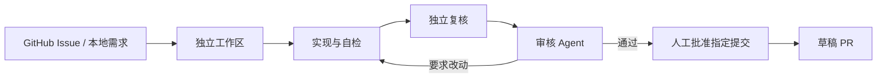

# RepoPilot

**把 GitHub Issue 交给研发 Agent，获得可验证、可审核的草稿 PR。**

RepoPilot 面向企业内部及个人维护的可信代码仓库，负责接单、隔离工作区、实现、自检、独立复核和审核返工。每次运行保留需求、补丁、检查、费用及审批证据；人工批准具体提交后，再推送分支并创建草稿 PR。

[快速开始](#快速开始) · [交付演示](docs/runtime-v2/DEMO.md) · [运行协议](docs/runtime-v2/README.md) · [架构与代码导航](docs/runtime-v2/ARCHITECTURE.md)



## 能做什么

| 能力 | 使用方式 |
| --- | --- |
| 工单驱动研发 | 手动接入 Issue，或按登记仓库和标签自动监听；每项任务独立 worktree |
| 通用仓库工具 | 文件读取、搜索、编辑和命名检查，不依赖 Python AST；语言与依赖由操作者配置 |
| 实现、验证、审核分离 | 编排层独立重跑登记检查，审核 Agent 绑定提交判断，支持有限次返工 |
| 暂停与恢复 | SQLite 保存阶段检查点与累计用量；中断现场需要显式核对，审批等待不占 worker |
| 可选 Docker 隔离 | 文件工具和检查进入阶段容器，禁网、限制资源，停止后校验产物；失败不回退宿主 |
| 可追溯仓库记忆 | 可选文件事实书签，带提交、文件指纹和人工确认；来源变化时失效 |
| 有证据的人工交接 | 单文件离线报告展示改动、检查、审核、审批与 PR，批准绑定完整 SHA |

核心使用 LangChain／LangGraph 的 Agent 工具循环、DeepSeek、Pydantic 和 SQLite；外层业务状态机负责预算、版本绑定、恢复及交付规则。[技术边界与取舍](docs/runtime-v2/ARCHITECTURE.md)区分已有机制与仍待验证的效果。

## 看一条真实交付

[zhixianji-jobs Issue #1](https://github.com/saikaji0314/zhixianji-jobs/issues/1) → 实现 → 104 项独立检查 → 两轮审核与一次返工 → 人工批准 → [草稿 PR #2](https://github.com/saikaji0314/zhixianji-jobs/pull/2)。该 PR 未合并。


报告把交付概览与详细证据分开：先看工单结果与下一步，再通过导航查看差异、检查输出和审核记录。支持窄屏与离线打开，不依赖前端服务、不调用模型、不执行审批。动图来自真实历史运行的只读浏览回放，不是实时进度。它不展示重复的模型对话，而是直接定位候选改动、检查、审核和交付证据。

[交付演示步骤](docs/runtime-v2/DEMO.md) · [展示材料与历史视频](docs/demo/README.md) · [真实交付验证](docs/runtime-v2/VALIDATION-05.md)

## 快速开始

需要 Python 3.12、Git 和模型 API；以下 JavaScript 示例另需 Node.js。Docker 是可选后端，不是默认安装前提。

```powershell
python -m venv .venv
.\.venv\Scripts\python.exe -m pip install -c constraints.txt -e ".[test]"
# 已有配置时保留，不覆盖
if (-not (Test-Path .env)) { Copy-Item .env.example .env }
```

在 `.env` 填写 `DS_API_KEY`。默认端点为 `https://api.deepseek.com`，模型为 `deepseek-flash`，支持通过 `DS_BASE_URL / DS_MODEL / DS_THINKING / DS_REASONING_EFFORT` 配置。凭证不写入任务 YAML 或 Git。

准备示例 Git 仓库，然后运行一项明确的小任务：

```powershell
# 示例文件随项目提供；首次使用时初始化其独立 Git 基线
$demo = "examples/runtime/fixtures/javascript"
git -C $demo init -q
git -C $demo add .
git -C $demo -c user.name=RepoPilot -c user.email=demo@example.test commit -m "demo baseline"

# 调用真实模型，会产生 API 费用
.\.venv\Scripts\repopilot.exe run examples/runtime/javascript-implement.yaml
# 从命令输出取得 RUN_ID，生成可离线查看的报告
.\.venv\Scripts\repopilot.exe report RUN_ID --html .local/demo/report.html
```

任务 YAML 指定仓库、需求和可信检查 argv。默认使用本机执行，仅用于可信仓库；启用容器前请按 [Docker 配置](docs/runtime-v2/SANDBOX.md)准备固定镜像和项目依赖。不同语言不需要重写 Agent，但需要相应构建环境和验收命令。

默认每次运行最多 36 次模型调用、40 次工具调用、12 次编辑、3 次返工、300 秒活跃时间和估算 2 元费用。累计预算默认 200 元，暂停恢复不重置账本；费用为估算，实际以供应商账单为准。较复杂任务的参数和 profile 见[运行协议](docs/runtime-v2/README.md)。

## 接入 GitHub 与交付

GitHub 接入另需 `GITHUB_TOKEN` 或 `GH_TOKEN`；权限按目标仓库配置，读取 Issue、推送分支与创建 PR 分别需要相应权限。Issue 提供需求，不能覆盖登记的路径和命令。

```powershell
.\.venv\Scripts\repopilot.exe issue https://github.com/OWNER/REPO/issues/1 --task task.yaml
.\.venv\Scripts\repopilot.exe jobs
.\.venv\Scripts\repopilot.exe status RUN_ID
.\.venv\Scripts\repopilot.exe report RUN_ID --html report.html
# 核对候选改动与证据后，批准具体提交；批准本身不推送
.\.venv\Scripts\repopilot.exe approve RUN_ID --commit FULL_SHA --reason "已核对差异与检查"
.\.venv\Scripts\repopilot.exe publish RUN_ID
```

交付终点为草稿 PR。独立检查失败、审核结论不足或批准后版本变化时不会发布。合并、软件发布和部署继续由仓库维护者决定，不在当前产品范围；有关取舍见[交付边界](docs/runtime-v2/DELIVERY-POLICY.md)。

自动监听可配置仓库、标签、轮询与并发上限：

```powershell
.\.venv\Scripts\repopilot.exe watch --config watch.yaml
.\.venv\Scripts\repopilot.exe watch --status
.\.venv\Scripts\repopilot.exe watch --stop
```

默认每 60 秒轮询，一个 worker，同一仓库一次一个任务。没有安装系统服务或开机自启；[监听协议](docs/runtime-v2/WATCH.md)提供配置、停止和残留核查方式。

## 验证与边界

真实模型和 GitHub 开发复测、FakeModel 流程测试、容器机制测试和修复评测分别记录，不相互替代：

- [真实交付](docs/runtime-v2/VALIDATION-05.md)：公开个人仓库的小规模开发复测，不能据此计算通用成功率。
- [容器接入](docs/runtime-v2/VALIDATION-11.md)：Python／Node 真实容器与确定性模型流程；尚无容器后端真实模型交付结论。
- [独立修复评分](evals/repair/README.md)：两个公开开发夹具验证评分机制，尚无隐藏留出题集成绩。
- [SWE-bench 开发评测](docs/runtime-v2/VALIDATION-15.md)：固定5题SymPy开发子集，2题通过官方验收，1题同时完成本地复核和审核；未修复与空补丁均保留。不是留出集或完整Lite成绩，不能外推通用成功率。
- [仓库记忆](docs/runtime-v2/MEMORY.md)：可追溯文件事实，尚无真实模型收益对照结论。

默认本机检查拥有当前用户权限。可选 Docker 后端有网络、资源、输出和产物边界，但没有工作卷磁盘配额、硬杀后自动回收或 microVM 级隔离；宿主 Git 和 Docker 控制面仍需信任。模型审核不能替代人工判断。运行数据默认放在被忽略的 `.local/runtime/`，不要提交密钥、原始会话或业务运行数据。

## 代码导航与文档

新版代码按职责分包，`repopilot/legacy/` 保存第一代 Python 诊断实现；`repopilot/runtime/` 只保留历史导入兼容。现有运行数据路径不变。升级现有 checkout 后重新执行可编辑安装，以更新命令入口。

| 入口 | 内容 |
| --- | --- |
| [架构与代码地图](docs/runtime-v2/ARCHITECTURE.md) | 包职责、调用链、新旧边界与阅读顺序 |
| [设计取舍与阅读路线](docs/runtime-v2/DESIGN.md) | 为什么这样划分职责、可替代方案及逐模块阅读任务 |
| [运行协议](docs/runtime-v2/README.md) | 工具、状态、恢复、预算和审批 |
| [Docker 后端](docs/runtime-v2/SANDBOX.md) | 环境准备、权限与产物导入 |
| [记忆协议](docs/runtime-v2/MEMORY.md) | 事实来源、检索与生命周期 |
| [历史实现](docs/legacy/README.md) | 旧入口、题集与诊断结果 |

Flask 源码与教程样例来自 Pallets，保留其上游 README 和 BSD-3-Clause 许可证。
