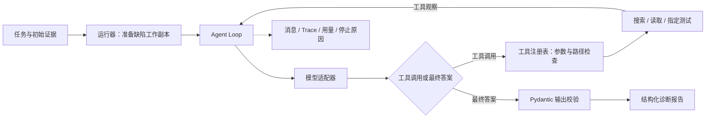

# 历史 Python 诊断版本

此目录归档旧版说明，代码和命令仍保持原路径；命令从仓库根执行。当前开发入口见[新版架构与现状](../runtime-v2/ARCHITECTURE.md)。

旧入口根据缺陷描述与初始日志，调查 Python 仓库、运行指定 pytest，输出根因、证据、修改建议与验证方案。旧技术栈为原生 Tool Calling、百炼 Qwen、Python AST 和 pytest。

## 一个典型场景

用户报告“文章作者编辑时收到 403，其他用户却能访问”。Agent 通过工具调查鉴权实现与测试，关联作者 ID 比较条件和两种用户行为，给出代码位置、修改建议及正反权限验证方案。

最终输出包含 `status`、`summary`、`root_cause`、`evidence`、`proposed_fix`、`verification`、`risks`。每次运行保留模型消息、工具结果和停止原因，可以核对答案依据，也能追查失败发生在哪一步。旧入口提供只读诊断与测试执行，修改建议由用户审阅后实施；直接改动文件使用[新版独立工作区流程](../runtime-v2/README.md)。

## 架构与执行链路



运行器负责基线预检、缺陷注入、环境选择与工具装配；Loop 负责消息循环、预算和停止条件；模型适配器隔离 SDK；检索模块负责符号索引和证据片段；评测端独立持有 Oracle。这样的边界使循环逻辑能够用 Fake 模型测试，检索算法也可以脱离模型 SDK 验证。

## 关键工程设计

| 设计 | 实现与取舍 | 代码入口 |
| --- | --- | --- |
| 显式 Agent Loop | 使用原生 `tools` / `tool_calls`，管理多轮消息与工具结果配对 | [loop.py](../../repopilot/legacy/agent/loop.py) |
| 受控工具执行 | 统一工具协议、Pydantic 参数校验、工作区路径检查、指定 pytest 目标 | [工具注册表](../../repopilot/legacy/tools/base.py)、[路径检查](../../repopilot/legacy/tools/path_guard.py) |
| 有限错误恢复 | 对允许的工具与错误组合提供一次纠错轮次；最终答案校验失败后提供一次无工具格式恢复，计入原预算 | [Loop 异常路径](../../repopilot/legacy/agent/loop.py) |
| 可配置资源限制 | 限制模型轮数、工具次数、累计 Token、估算费用及执行时间 | [agent.yaml](../../configs/agent.yaml) |
| 轻量代码检索 | AST 提取函数与类位置，按名称和路径排序；结果去重并按字符预算选择片段 | [retrieval](../../repopilot/legacy/retrieval/index.py) |
| 可追踪与可比较 | 保存实际工具定义、初始消息、配置和任务哈希；对照脚本固定任务并交替执行两组方案 | [运行器](../../repopilot/legacy/agent_runner.py)、[对照脚本](../../scripts/compare_retrieval.py) |

工具包括 `list_files`、`read_file`、`search_code`、`run_test`，以及可选的 `search_symbols`。字面搜索用于变量、配置键与调用位置，符号检索用于已知函数或类的定义定位。索引在缺陷工作副本准备后构建，避免读取干净版本；通过 AST 解析源码，无需导入被分析模块。

## 评测结果与发现

题集包含 10 条受控缺陷任务，覆盖 Flaskr 鉴权、密码校验、输入边界、排序、事务、配置，跨文件工单筛选与缓存，以及 Flask 框架的 Blueprint 与 Session 行为。每题分离 Agent 输入与评测答案；严格通过要求达到评分线且满足全部硬条件。

| 实验 | 样本 | 严格通过 | 估算模型费用 |
| --- | --- | --- | ---: |
| 单次 LLM 全文基线 | 6 题 × 2 次 | 8/12 | ¥0.379332 |
| 只读 Agent 六题批次 | 6 题 × 1 次 | 4/6 | ¥0.409940 |
| 四工具检索方案 | 10 题 × 1 次 | 5/10 | ¥0.984730 |
| 五工具检索方案 | 10 题 × 1 次 | 4/10 | ¥1.202716 |

前两项用于观察全文输入与主动调查的行为，样本和配置不同，不能直接推导效果提升。后两项使用固定模型、任务和预算进行方案对照；新增符号工具自然被使用的任务为 2/10，本次初筛尚未证明端到端收益。

对照实验还暴露了两类主要瓶颈：获得相关代码后仍缺少完整调用链或副作用验证，以及最终输出协议失败。项目将证据命中、合法答案和严格诊断通过分别记录，后续优化据此判断应调整检索、收尾策略还是协议处理。每题每组一次的结果不支持统计显著性结论。

详细评分与失败案例：[基线报告](../../evals/reports/baseline-v1.md) · [六题 Agent 报告](../../evals/reports/agent-v2.md) · [检索对照报告](../../evals/reports/retrieval-comparison-v1.md)。费用按配置单价估算；原始模型日志未随仓库分发，重新运行可生成轨迹。本题集为受控构造任务。

## 本地运行

准备 Python 3.12、Git，在仓库根目录使用 PowerShell：

```powershell
python -m venv .venv
.\.venv\Scripts\python.exe -m pip install -e .
.\.venv\Scripts\python.exe -m pytest -q
Copy-Item .env.example .env
```

在 `.env` 中配置 `DASHSCOPE_API_KEY` 和 `DASHSCOPE_WORKSPACE_ID`（当前配置校验要求两项均填写）。模型与预算在 `configs/agent.yaml` 配置。运行一条诊断任务（会调用模型并产生费用）：

```powershell
.\.venv\Scripts\python.exe -m scripts.run_agent --task flaskr-auth-001 --repetitions 1
```

结果保存到 `evals/runs/agent/<batch>/<task>/run-01/`：

| 文件 | 内容 |
| --- | --- |
| `final_answer.json` | 通过输出协议校验的诊断；失败时可能不存在 |
| `summary.json` | 运行终态、用量、耗时及停止原因 |
| `messages.json` / `trace.jsonl` | 模型消息和逐步事件记录 |
| `runtime.json` / `task.json` | 实际配置、工具定义及可见任务快照 |

比较检索方案：

```powershell
.\.venv\Scripts\python.exe -m scripts.run_agent --task flaskr-auth-001 --repetitions 1 --retrieval-mode code
.\.venv\Scripts\python.exe -m scripts.run_agent --task flaskr-auth-001 --repetitions 1 --retrieval-mode symbols
```

运行 Flask 源码任务 009/010 或完整十题对照前，需准备独立环境：

```powershell
.\.venv\Scripts\python.exe -m venv .venv-flask-source
.\.venv-flask-source\Scripts\python.exe -m pip install -r configs/flask-source-test-requirements.txt
.\.venv\Scripts\python.exe -m scripts.verify_flask_source_tasks
```

全题对照命令为 `python -m scripts.compare_retrieval`，会产生多次模型调用；指标采集后的严格评分需要按 Oracle 审核。更多说明见 [评测复现](../phase-2/EVALUATION.md)。自动化测试主要使用 Fake/Mock 模型，缺少独立环境或系统条件时部分测试会跳过。

## 代码与文档导航

```text
repopilot/legacy/agent/       模型适配、循环协议与 Trace
repopilot/legacy/tools/       工具注册、参数模型与执行边界
repopilot/legacy/retrieval/   AST 索引、排序与上下文片段
scripts/              运行、预检与对照入口
evals/tasks/          任务输入、缺陷补丁和评测 Oracle
evals/reports/        已归档的评测结果与失败分析
target-repos/         固定版本的被测仓库
tests/                循环、工具、检索及题集回归测试
```

- [任务建模与基线](../phase-0/README.md)
- [Agent 执行引擎](../phase-1/README.md)
- [代码检索与上下文](../phase-2/README.md)
- [评测任务说明](../../evals/tasks/README.md)
- [被测仓库与来源](../../target-repos/README.md)


Flask 源码与教程样例来自 Pallets，保留其上游 README 和 BSD-3-Clause 许可证。


源码位置更新（2026-10-18）：第一代实现已集中到 `repopilot/legacy/`，Python导入使用 `repopilot.legacy.*`。从0.1.0rc1起安装包只提供新版CLI，不再安装`run-baseline`；历史运行需在完整源码根目录使用 `python -c "from repopilot.legacy.baseline import main; main()" --all`，并准备原配置与题集。新版独立评分位于 `repopilot/evaluation/`，不属于本历史实现。题集、补丁与历史报告保留原路径。
