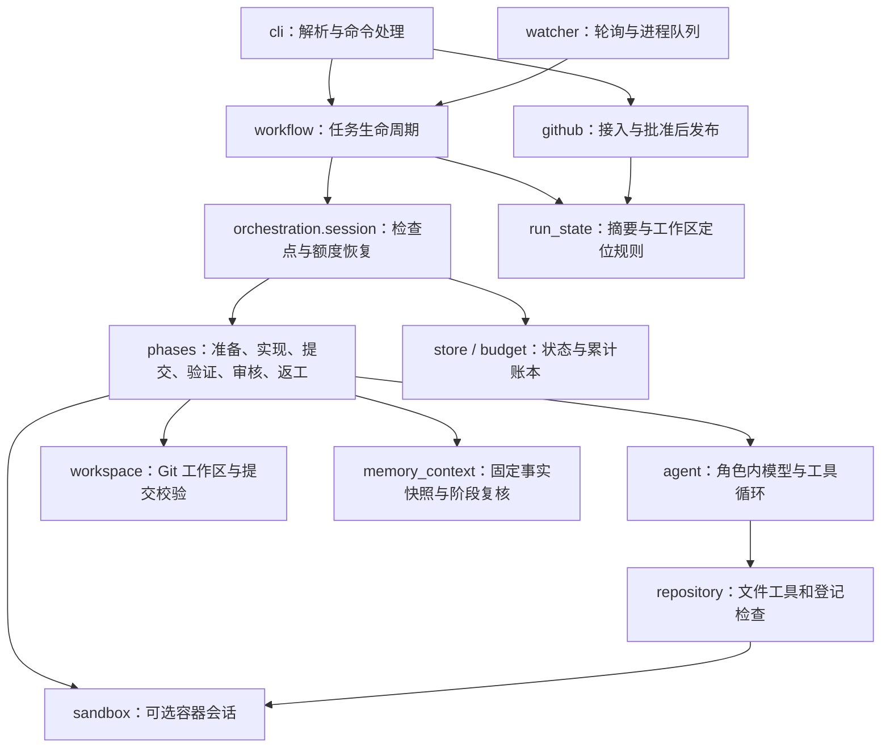

# 当前能力、实现结构与演进边界

截至2026-10-29，RepoPilot是面向可信仓库的Issue驱动研发运行时，支持默认本机和可选Docker执行。默认交付到人工批准后的草稿PR／MR；GitHub可按运行启用负责人原生Approve、基线更新及冲突处理、重新验证和受控合并确认。软件发行和部署另行决定。本文描述实际代码，真实证据与未验证范围见[验证总览](../VALIDATION.md)。

2026-10-27新增：工作区任务可以本地等待需求补充，使用CLI记录版本绑定的答复后恢复；批准和现场恢复进入同一请求记录。详见[人工协作](HUMAN.md)。M3进一步加入默认规划阶段、任务说明版本、集中提问批次、Issue评论自动投递／有节制轮询与按需子Issue映射，见[计划](PLANNING.md)。

2026-10-28 M4新增[并行实现与内部整合](PARALLEL.md)：可并行计划最多2个全局实现槽位，每个子任务独立worktree、依赖从已整合父HEAD开始，完成后串行合入父临时工作区并做组合检查。

同日M5新增[双视角审核、发现合并与争议复核](REVIEW.md)：正确性与需求上下文两个只读视角并行审核同一固定提交和依据，首轮上下文独立；程序合并去重发现、区分阻断与偏好、判定证据状态，复审逐条回应固定ID；只有复审回应冲突才启动 A／B＋C，仍无法判断时交负责人；同一提交同一依据可复用已有结论，需求和证据变化会使旧审核与批准失效。M6已在新GitHub任务中完成真实模型双审到固定SHA批准后的草稿交付，具体结果与执行后端边界见[增量30](../VALIDATION.md#历史机制验收)；未证明双审收益或真实平台争议效果。

同日M2新增[项目资料与决定管理](KNOWLEDGE.md)：正文版本文件、SQLite增量索引、版本确认和固定清单，现有实现／审核可分段读取原文，资料变化触发人工刷新。结构化机器决定是提议，人工答复带来源导出为任务资料；尚无真实模型收益结论。

M3本地机制验证见[增量27](../VALIDATION.md#历史机制验收)：确定性模型与模拟平台替身，不代表真实评论、子Issue或规划效果。

## 原始需求对应到哪里

| 原始流程 | 已有实现 | 验证与边界 |
| --- | --- | --- |
| 以 Issue 触发 | 手动 URL 接入；按登记仓库、标签和创建时间轮询；队列去重 | 真实 Issue #1 手动接入，#3 自动接入；使用轮询，没有 webhook |
| 验证问题、确认需求 | 实现／审核可提出问题，工作区任务保存现场等待CLI答复，恢复时传递业务补充并更新证据；新任务默认先规划，Issue任务等待时自动发问题批次到父Issue评论并由监听器有节制地读取负责人回复 | 平台评论只能采纳登记负责人，只有模拟协议和本地队列验证；没有真实平台评论往返结论，其他评论仅作线索 |
| 规划与子任务 | 默认规划Agent只读资料和源码，生成带验收／依赖／修改边界的计划；程序校验无环、按拓扑排序，支持顺序或最多2路独立worktree并行；结果串行整合到父临时工作区并做组合检查；组合候选再交双视角审核与按需争议复核；按需映射子Issue，重试不重复创建 | 新真实小任务选择单Agent路径；真实模型并行效果和Docker并行未验证；暂停后不自动续用未提交的并行编辑 |
| 开独立工作区 | 固定基线提交，每次运行独立 Git worktree，核对原仓库与远端身份 | 本机 Git；不自动为各语言安装环境或依赖 |
| 写代码、测试 | 通用 UTF-8 文件工具、精确替换与写入、命名检查；限制编辑与调用次数 | 工具不依赖 Python AST；Python、JavaScript 小样例已验证，不代表所有语言生态都已验证 |
| 审核与返工循环 | 编排层独立重跑全部登记检查；正确性／需求上下文两个只读视角并行审同一固定提交和依据，程序合并发现、只对具体争议启动A／B＋C，最多三次修改后交接 | 常规双审已有多个真实小任务交付；A／B＋C仍只有确定性替身，具体边界见验证总览 |
| 中断后继续 | SQLite 状态、阶段检查点、显式恢复、重试留档、累计费用账本 | 阶段内部中断需要操作者核查；不逐条恢复模型会话，不提供跨机器恢复 |
| 人工审批 | CLI 批准或拒绝，绑定完整 SHA 及需求、验证、审核摘要 | 审批后版本变化失效；没有用户身份、RBAC 或审批网页 |
| PR 交付 | 批准后推送 feature 分支、创建草稿 PR；重复发布核对远端结果 | 已有PR #5草稿和App作者PR #7自动合并记录；创建草稿需批准完整SHA，合并另需原生Approve |
| 多 Issue 开发 | 持久化队列、有上限的 worker 进程池、同仓库限流、单任务锁 | 默认一个 worker；真实进程并发探针通过，未验证多个真实模型工单同时开发的效果 |
| 合并与发布 | GitHub按运行启用负责人原生Approve、CI／保护核对、基线更新、冲突处理、重验与合并确认 | 正常合并已有真实记录；真实冲突样本正在执行；软件发行和部署未接入 |

当前真实证据是 [Issue #1](https://github.com/saikaji0314/zhixianji-jobs/issues/1) → [草稿 PR #2](https://github.com/saikaji0314/zhixianji-jobs/pull/2)，104 项独立检查、两轮审核及一次返工；[Issue #3](https://github.com/saikaji0314/zhixianji-jobs/issues/3) 经监听自动接入，93 项检查、两轮审核及一次返工后等待人审，未发布 PR。详情与失败尝试见 [VALIDATION-05](../VALIDATION.md#历史机制验收)。这些是开发复测，不能据此计算通用修复成功率。

## 这些概念实际做到哪一层

| 概念／技术 | 具体实现 | 尚未具备 |
| --- | --- | --- |
| Harness／轻量 AI 基础设施 | 宿主控制工具、状态、检查、预算、审批和发布；模型只提出受限动作与报告 | 面向不可信租户的隔离执行平台、分布式调度及服务运维体系 |
| LangChain／LangGraph | `create_agent` 承载单个角色内部的模型与工具循环；Pydantic 校验报告；DeepSeek 适配 | 外层业务流程是自定义 Python 状态机与 SQLite，未采用 LangGraph StateGraph／checkpointer |
| Multi-agent | 实现与两个审核视角、按需的争议复核A／B／C角色；提示、工具权限、输出协议不同；默认使用同一可配置模型 | 角色独立不等于判断独立；没有多模型委员会或自由协商网络。真实双审小样本通过不证明收益；A／B＋C尚无真实模型结论 |
| Memory／上下文 | 当前上下文清理、宿主进度与状态持久化；可选跨运行文件事实书签，带提交来源、依赖指纹和人工生命周期 | 尚无任务经验归纳、长期语义检索、向量库或真实模型收益结论；检查点与文件事实分别管理 |
| 项目资料与决定 | 文档正文／历史版本在文件中，SQLite保存位置、来源、关系与FTS5词项；确认绑定版本，实现／审核共用固定清单，变更／丢失需刷新再验证 | 关键词检索不等于语义检索；决定完整性依赖报告，尚未做真实任务效果／记忆收益对照；不提供多机资料同步 |
| 评测 | Fake／Mock协议验证、真实GitHub交付、官方SWE-bench评分及冻结的上下文／记忆开关开发对照，见[增量22](../../evals/reports/context-memory-20261019.md) | 尚无独立留出集和统计成功率；小样本组件收益不稳定，执行故障另列，不将命中或正确补丁当完整交付 |
| 安全与可靠性 | 路径／链接约束、登记 argv、用量预留、版本绑定、锁与显式恢复；可选按阶段 Docker 隔离、禁网、资源与输出限额、停止后校验导入 | 工作卷磁盘配额、硬杀自动回收、更强虚拟机隔离、身份鉴权、不可篡改审计、完整提示注入防御；默认 local 检查仍有本机权限 |

“专项”已有较清楚的落点：**围绕可恢复、可审核、受预算约束的 Issue 到 PR 交付 harness**。评测、Memory、安全都有关联，但当前不能把三者均描述为深入完成的专项。下一步若要形成可比较的效果证据，应优先建立独立修复评测及失败分类，再按失败证据选择加强哪一层。

## 如何读代码

从新流程走到交付的操作、验收与逐模块导航见[交付验收](DELIVERY-ACCEPTANCE.md)。报告新增`presentation.traceability`呈现人工来源、依据版本和决定理由；`knowledge.reader`复用历史正文校验，用只读SQLite连接避免报告触发索引同步或旧库迁移；CLI按运行目录定位正文，与脱敏路径分开。本轮真实小任务、批准状态和效果边界见[增量30](../VALIDATION.md#历史机制验收)。



| 文件 | 职责与阅读重点 |
| --- | --- |
| [cli.py](../../repopilot/cli.py) | 参数解析、按命令加载凭证、调用应用操作、统一 JSON 与退出码；`main` 不承载整套业务 |
| [orchestration/workflow.py](../../repopilot/orchestration/workflow.py) | `create_job/start/resume/retry/decide/recover/snapshot`：任务身份、生命周期、审批与结果；入口协议保持兼容 |
| [orchestration/session.py](../../repopilot/orchestration/session.py) | `RunSession`：恢复计数与活跃时间、统一保存脱敏检查点；`execute_run` 调度阶段，集中映射错误状态 |
| [orchestration/phases.py](../../repopilot/orchestration/phases.py) | `PhaseRunner` 每个阶段一个方法；实现／审核载荷与结果转换分开，检查点由执行会话控制，固定基线仍在副作用前落盘；并行计划在这里调度worker和整合 |
| [orchestration/parallel.py](../../repopilot/orchestration/parallel.py)、[orchestration/slots.py](../../repopilot/orchestration/slots.py) | 独立worktree子任务执行、cherry-pick串行整合和冲突修复入口；跨运行SQLite槽位租约，默认最多2个实现Agent |
| [orchestration/state.py](../../repopilot/orchestration/state.py) | 终态集合、规范哈希、批准摘要、从持久化状态定位工作区；避免发布层依赖整套执行流程 |
| [agents/loop.py](../../repopilot/agents/loop.py) | 角色内循环、上下文与进度中间件、用量控制、独立检查入口 |
| [agents/context.py](../../repopilot/agents/context.py) | 阶段内源码观察工作集、有界请求及会话更新；与跨运行仓库记忆分开，见[上下文](CONTEXT.md) |
| [agents/models.py](../../repopilot/agents/models.py)、[reports.py](../../repopilot/agents/reports.py)、[prompts.py](../../repopilot/agents/prompts.py)、[trace.py](../../repopilot/agents/trace.py) | 分别管理供应商适配、报告契约、固定角色提示与脱敏日志；修改提示与整理代码分别验证 |
| [execution/repository.py](../../repopilot/execution/repository.py)、[execution/workspace.py](../../repopilot/execution/workspace.py) | 文件访问、受控命令、编辑限额；Git 基线、差异、提交、干净状态核对 |
| [execution/sandbox.py](../../repopilot/execution/sandbox.py)、[execution/transport.py](../../repopilot/execution/transport.py) | 阶段会话、Docker 生命周期、文件协议与登记检查；有界 CLI 传输，失败不回退宿主 |
| [execution/files.py](../../repopilot/execution/files.py)、[execution/worker.py](../../repopilot/execution/worker.py)、[execution/archive.py](../../repopilot/execution/archive.py) | 无模型依赖的共用文件规则；容器固定操作协议；完整校验后导入普通文件 |
| [storage/jobs.py](../../repopilot/storage/jobs.py)、[storage/budget.py](../../repopilot/storage/budget.py) | SQLite 状态与乐观并发、进程锁；模型费用预留、结算、共享累计上限 |
| [collaboration/requests.py](../../repopilot/collaboration/requests.py)、[orchestration/human.py](../../repopilot/orchestration/human.py) | 人工请求协议、去重与版本绑定，答复后保留用量恢复，复用审批和现场核对 |
| [collaboration/questions.py](../../repopilot/collaboration/questions.py)、[collaboration/comments.py](../../repopilot/collaboration/comments.py) | 批次编号／去重与上限、最终缺口；Issue评论正文、负责人过滤和引用剔除，不做网络请求 |
| [planning/contracts.py](../../repopilot/planning/contracts.py)、[planner.py](../../repopilot/planning/planner.py)、[brief.py](../../repopilot/planning/brief.py) | 计划报告契约、依赖校验与拓扑顺序、子任务进度、任务说明版本；不直接执行模型 |
| [review/contracts.py](../../repopilot/review/contracts.py)、[merge.py](../../repopilot/review/merge.py)、[basis.py](../../repopilot/review/basis.py) | 合并发现与争议记录、去重和阻断判定、审核依据快照与失效；纯规则，不调用模型 |
| [review/rounds.py](../../repopilot/review/rounds.py)、[runner.py](../../repopilot/review/runner.py)、[disputes.py](../../repopilot/review/disputes.py) | 一轮双审的并行执行与落盘、A／B／C争议复核、恢复与同版本复用；模型只产出报告 |
| [review/outcome.py](../../repopilot/review/outcome.py)、[review/gate.py](../../repopilot/review/gate.py)、[review/cli.py](../../repopilot/review/cli.py) | 审核结论到返工／批准／交接的状态推进、争议人工判断与修改额度延长、只读查看命令 |
| [planning/mapping.py](../../repopilot/planning/mapping.py)、[planning/cli.py](../../repopilot/planning/cli.py) | 计划到子Issue的幂等映射、平台不支持时保留本地映射；计划查看命令 |
| [knowledge/store.py](../../repopilot/knowledge/store.py)、[retrieval.py](../../repopilot/knowledge/retrieval.py)、[orchestration/knowledge.py](../../repopilot/orchestration/knowledge.py) | 正文与增量索引、来源关联与任务范围检索、固定清单和失效／刷新；代码事实仍由memory管理 |
| [delivery/forge.py](../../repopilot/delivery/forge.py)、[delivery/github.py](../../repopilot/delivery/github.py)、[delivery/gitlab.py](../../repopilot/delivery/gitlab.py) | 平台识别、凭证路由与唯一的发布流程；GitHub／GitLab 各自的 REST 与 Git 差异，见[平台接入](FORGES.md) |
| [delivery/watcher.py](../../repopilot/delivery/watcher.py) | 轮询准入、按仓库来源选择平台、有界进程调度与停止 |
| [delivery/queue.py](../../repopilot/delivery/queue.py) | SQLite 去重、领取、任务绑定、心跳与残留任务确认；不启动进程或调用模型 |
| [core/config.py](../../repopilot/core/config.py) | 任务／检查／模型／限额协议、环境与执行 profile 校验 |
| [memory/store.py](../../repopilot/memory/store.py)、[memory/facts.py](../../repopilot/memory/facts.py) | SQLite仓库事实、人工确认／撤销／删除、有界检索；Git来源和文件／依赖指纹校验 |
| [memory/context.py](../../repopilot/memory/context.py)、[memory/cli.py](../../repopilot/memory/cli.py) | 运行开始冻结命中、阶段前复核、审核后收集候选；可信操作者管理入口，见[记忆协议](MEMORY.md) |

## 当前包结构与依赖方向

```text
repopilot/
  cli.py                 命令入口与参数，不承载业务流程
  core/config.py         任务、模型与执行后端契约
  orchestration/         workflow生命周期、session检查点、phases业务阶段、parallel并行整合、slots槽位、state版本规则
  collaboration/         人工请求、提问批次与Issue评论正文，不承载模型循环
  planning/              任务说明、计划校验与顺序执行辅助、子Issue映射
  review/                双视角审核、发现合并、A／B＋C争议复核、依据与人工判断入口
  agents/                loop循环与限额、models适配、reports契约、prompts角色提示、trace证据
  execution/             文件工具、Git工作区、容器会话、传输和归档校验
  storage/               jobs状态与锁、budget累计费用
  memory/                事实存储、来源校验、阶段检索及管理入口
  delivery/              平台接入、发布、watcher监听调度、queue持久化与健康判断
  presentation/          只读报告装配、证据片段、格式化、概览布局与内联样式
  evaluation/            新版独立修复评分，属于当前实现
  legacy/                第一代Python诊断、AST检索和旧工具
  runtime/               历史导入与模块命令兼容，不再新增业务代码
```

依赖方向：CLI调用编排或交付操作；编排组合Agent、执行、存储和记忆；展示只读取状态与证据。新版不导入legacy。`core`保存契约，避免业务包互相定义重复配置；包拆分不引入微服务、RPC或新框架。

阅读一条交付链：`core.config.Task` → `cli._run_task` → `orchestration.workflow.start/resume` → `orchestration.session.execute_run` → `orchestration.phases.PhaseRunner` → `agents.loop.run_phase`，再看 `workflow.decide` 与 `delivery.forge.publish`。报告入口为 `presentation.report`，片段、布局和证据格式分别在 `sections / layout / formatting`，不再由一个长函数同时处理整页。

`agents.loop`集中处理角色内执行与限额；协议、提示和日志已拆出，旧导入名继续指向同一对象。监听调度使用独立的`delivery.queue.IssueQueue`，旧`watcher.IssueQueue`保持可用。拆分没有更改提示文本、报告字段、SQL／数据库结构和持久化状态字典，也不改变审批及发布规则。

## 新旧实现与迁移兼容

正式入口改为 `repopilot.cli:main`；旧的 `python -m repopilot.runtime.cli` 保留兼容。历史 `repopilot.runtime.<模块>` 映射到同一个实际模块对象，而非复制实现，避免两份模块状态或 monkeypatch 分叉。新代码及仓库内调用方使用实际包路径。兼容层集中在runtime的短映射表，后续新模块不继续登记旧别名。

第一代源码统一移入 `repopilot.legacy`，内部导入与维护脚本已迁移；旧Python导入应改用 `repopilot.legacy.*`。0.1.0rc1起wheel仅安装新版`repopilot`命令，旧基线需要完整源码与题集，调用方式见[历史说明](../legacy/README.md)。升级现有checkout后重新执行可编辑安装以更新命令入口。新版独立修复评测 `repopilot.evaluation` 不属于legacy。

外部任务YAML、状态字段、SQLite数据库、运行ID、预算、活动配置、`.local`目标仓库和worktree路径不迁移。旧产物中的源码位置代表当时版本，不批量改写历史证据。旧题集和报告保留原目录，旧说明见[历史实现](../legacy/README.md)。两版仍共用一个发行包和依赖，尚未拆分optional dependencies；不把目录分开等同于独立发布产品。

## 尚待打磨的交付效果

默认交付草稿PR；可选受控合并见[合并协议](MERGING.md)，软件发行／部署仍单列于[交付边界](DELIVERY-POLICY.md)。当前差距包括长期运行与效果验证：监听尚无系统服务、自启、崩溃自恢复或长期压测；`watch --status`区分新鲜与过期心跳，但仍须结合PID、锁和日志判断。独立评分最小骨架见[两题开发评测](../../evals/repair/README.md)，不能把控制补丁得分当作模型修复成功率。

后续可按验收收益依次处理：独立修复题集与失败统计；监听健康判断和服务部署；多候选基线变化与冲突协调；接入 CI 与合并策略。长期 Memory 或更强隔离应由真实失败及部署需求驱动，而不是同时扩展所有方向。当前范围的展示方法见 [DEMO](DEMO.md)，本次结构调整验证见 [VALIDATION-06](../VALIDATION.md#历史机制验收)。

尚未完成的方向见[后续范围](../ROADMAP.md)。[Docker后端](SANDBOX.md)已接入运行时，Python／Node真实容器、确定性流程及真实模型交付按[验证总览](../VALIDATION.md)分别记录，不外推隔离强度或模型效果。


当前设计选择、替代方案与逐模块阅读任务见[设计取舍与代码阅读](DESIGN.md)；展示与本次分包验证见[VALIDATION-12](../VALIDATION.md#历史机制验收)。
