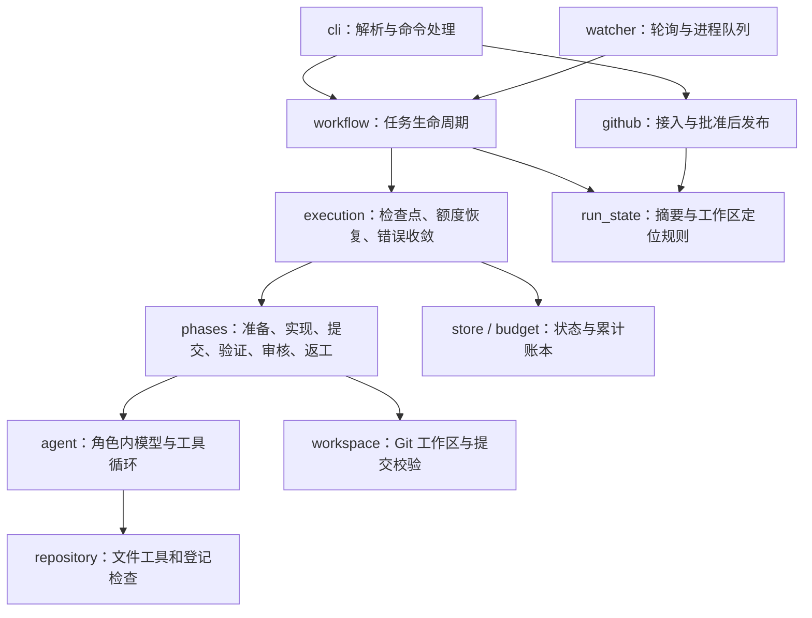

# 当前能力、实现结构与演进边界

截至 2026-10-17，RepoPilot 是面向可信本机仓库的 Issue 驱动研发运行时。当前交付终点是人工批准后的 GitHub 草稿 PR；尚未覆盖原愿景中的自动合并和软件发布。本文描述实际代码，未来方向不视作已有能力。

## 原始需求对应到哪里

| 原始流程 | 已有实现 | 验证与边界 |
| --- | --- | --- |
| 以 Issue 触发 | 手动 URL 接入；按登记仓库、标签和创建时间轮询；队列去重 | 真实 Issue #1 手动接入，#3 自动接入；使用轮询，没有 webhook |
| 验证问题、确认需求 | 实现 Agent 读取需求和仓库、运行检查；结构化报告可说明阻塞和待确认问题 | 没有独立需求澄清阶段，也没有自动与 Issue 作者往返讨论 |
| 开独立工作区 | 固定基线提交，每次运行独立 Git worktree，核对原仓库与远端身份 | 本机 Git；不自动为各语言安装环境或依赖 |
| 写代码、测试 | 通用 UTF-8 文件工具、精确替换与写入、命名检查；限制编辑与调用次数 | 工具不依赖 Python AST；Python、JavaScript 小样例已验证，不代表所有语言生态都已验证 |
| 审核与返工循环 | 宿主独立重跑全部登记检查；只读审核 Agent；有限次返工并重新提交、检查和审核 | 审核绑定提交，检查失败可否决模型批准；仍需要人判断需求和测试是否充分 |
| 中断后继续 | SQLite 状态、阶段检查点、显式恢复、重试留档、累计费用账本 | 阶段内部中断需要操作者核查；不逐条恢复模型会话，不提供跨机器恢复 |
| 人工审批 | CLI 批准或拒绝，绑定完整 SHA 及需求、验证、审核摘要 | 审批后版本变化失效；没有用户身份、RBAC 或审批网页 |
| PR 交付 | 批准后推送 feature 分支、创建草稿 PR；重复发布核对远端结果 | 真实 PR #2 已创建；审核通过本身不会自动推送 |
| 多 Issue 开发 | 持久化队列、有上限的 worker 进程池、同仓库限流、单任务锁 | 默认一个 worker；真实进程并发探针通过，未验证多个真实模型工单同时开发的效果 |
| 合并与发布 | 尚未实现 | 合并冲突、基线更新、重跑检查、新审批、CI 与发布策略都还需设计 |

当前真实证据是 [Issue #1](https://github.com/saikaji0314/zhixianji-jobs/issues/1) → [草稿 PR #2](https://github.com/saikaji0314/zhixianji-jobs/pull/2)，104 项独立检查、两轮审核及一次返工；[Issue #3](https://github.com/saikaji0314/zhixianji-jobs/issues/3) 经监听自动接入，93 项检查、两轮审核及一次返工后等待人审，未发布 PR。详情与失败尝试见 [VALIDATION-05](VALIDATION-05.md)。这些是开发复测，不能据此计算通用修复成功率。

## 这些概念实际做到哪一层

| 概念／技术 | 具体实现 | 尚未具备 |
| --- | --- | --- |
| Harness／轻量 AI 基础设施 | 宿主控制工具、状态、检查、预算、审批和发布；模型只提出受限动作与报告 | 面向不可信租户的隔离执行平台、分布式调度及服务运维体系 |
| LangChain／LangGraph | `create_agent` 承载单个角色内部的模型与工具循环；Pydantic 校验报告；DeepSeek 适配 | 外层业务流程是自定义 Python 状态机与 SQLite，未采用 LangGraph StateGraph／checkpointer |
| Multi-agent | 实现与审核两个角色，提示、工具权限、输出协议不同；默认使用同一可配置模型，顺序执行 | 角色独立不等于判断独立；没有多模型委员会或自由协商网络。多 Issue worker 并发属于任务调度 |
| Memory／上下文 | 当前运行的消息、按字节清理旧读取结果、宿主进度反馈、状态持久化 | 跨任务经验检索、长期语义记忆、向量库；SQLite 检查点不能称作长期智能 Memory |
| 评测 | Fake／Mock 验证状态与边界；真实模型与 GitHub 开发复测；保留失败和费用证据 | 新版尚无独立留出修复题集、重复实验和统计成功率。旧版诊断题集不能直接当新版修复成绩 |
| 安全与可靠性 | 路径／链接约束、登记 argv、子进程环境清理、用量预留、版本绑定、锁与显式恢复 | Docker／OS 沙箱、身份鉴权、不可篡改审计、完整提示注入防御；仓库检查代码仍以当前用户权限执行 |

“专项”已有较清楚的落点：**围绕可恢复、可审核、受预算约束的 Issue 到 PR 交付 harness**。评测、Memory、安全都有关联，但当前不能把三者均描述为深入完成的专项。下一步若要形成可比较的效果证据，应优先建立独立修复评测及失败分类，再按失败证据选择加强哪一层。

## 如何读代码

| 文件 | 职责与阅读重点 |
| --- | --- |
| [cli.py](../../repopilot/runtime/cli.py) | 参数解析、按命令加载凭证、调用应用操作、统一 JSON 与退出码；`main` 不承载整套业务 |
| [workflow.py](../../repopilot/runtime/workflow.py) | `create_job/start/resume/retry/decide/recover/snapshot`：任务身份、生命周期、审批与结果；入口协议保持兼容 |
| [execution.py](../../repopilot/runtime/execution.py) | `RunSession`：恢复计数与活跃时间、统一保存脱敏检查点；`execute_run` 调度阶段，集中映射错误状态 |
| [phases.py](../../repopilot/runtime/phases.py) | `PhaseRunner` 每个阶段一个方法；实现／审核载荷与结果转换分开，检查点由执行会话控制，固定基线仍在副作用前落盘 |
| [run_state.py](../../repopilot/runtime/run_state.py) | 终态集合、规范哈希、批准摘要、从持久化状态定位工作区；避免发布层依赖整套执行流程 |
| [agent.py](../../repopilot/runtime/agent.py) | DeepSeek 接线、结构化报告、上下文与进度中间件、角色内循环、独立检查入口 |
| [repository.py](../../repopilot/runtime/repository.py)、[workspace.py](../../repopilot/runtime/workspace.py) | 文件访问、受控命令、编辑限额；Git 基线、差异、提交、干净状态核对 |
| [store.py](../../repopilot/runtime/store.py)、[budget.py](../../repopilot/runtime/budget.py) | SQLite 状态与乐观并发、进程锁；模型费用预留、结算、共享累计上限 |
| [github.py](../../repopilot/runtime/github.py)、[watcher.py](../../repopilot/runtime/watcher.py) | GitHub API 与 Git 发布；轮询准入、去重、worker 调度、停止与残留核查 |
| [config.py](../../repopilot/runtime/config.py) | 任务／检查／模型／限额协议、环境与执行 profile 校验 |

结构调整保留 `runtime` 包名、CLI、状态格式和模型提示，不引入另一个服务框架。`workflow` 保留原有状态辅助函数的导出，以兼容已有调用方。长函数并非一律需要拆分：继续保留内聚的检查、数据库事务和工具装配；以后按行为变化拆分，避免只为压行数增加跳转。

仍有可读性债务：持久化状态使用字典，字段与阶段不变量主要由入口和测试约束；`agent.py` 同时包含模型适配、中间件与报告协议；`watcher.py` 同时包含队列与调度。它们可在后续相关功能增量中分别引入明确状态类型、拆出模型适配或队列存储，本次没有同时重写，避免扩大恢复与交付行为的变更面。

推荐阅读顺序：`config.Task` → `cli._run_task` → `workflow.start/resume` → `execution.execute_run` → `PhaseRunner` 各阶段 → `agent.run_phase`，最后看 `decide` 与 `github.publish`。先跟一条成功路径，再跟一次检查失败或中断恢复路径。

## 新旧实现的关系与处理原则

新版运行入口为 `repopilot.runtime.cli:main`，`runtime` 不导入旧版 `repopilot.agent`、`tools`、`retrieval`、`task_loader` 等业务模块；所有 runtime 模块在禁用旧模块导入时可独立加载，由边界测试持续检查。新版无需百炼凭证或旧诊断题集才能执行。

但两版仍在同一个发行包：`pyproject.toml` 共同安装依赖，保留 `run-baseline`，测试和被测仓库也共处一仓库。因此“业务代码不依赖旧版”不等于“已拆成独立安装包”。

当前采用保留与冻结策略：

- 新功能写在 `runtime`；旧代码、脚本、题集和报告保留原路径，旧入口说明移到 [历史实现说明](../legacy/README.md)。
- 不为了外观把旧代码统一挪到 `legacy/`：这会打断脚本、导入、测试及历史证据；当前没有功能收益。
- 旧评测的 Oracle 分离、失败分类等方法可借鉴；新版修复评测需要单独定义输入、验收和独立检查，不能直接继承旧分数。
- 真正需要简化安装或停止支持旧入口时，再单独拆 optional dependencies、弃用入口并验证迁移；本次没有删除旧实现或变更依赖版本。

## 尚待打磨的交付效果

当前最明显差距是长期运行与效果验证：监听有心跳但还没有系统服务、自启、崩溃自恢复或长期压测；`watch --status` 返回的是最后写入心跳，不能仅凭其中的 `running` 字段认定进程仍活着，应结合时间、PID 与锁判断。

后续可按验收收益依次处理：独立修复题集与失败统计；监听健康判断和服务部署；多候选基线变化与冲突协调；接入 CI 与合并策略。长期 Memory 或更强隔离应由真实失败及部署需求驱动，而不是同时扩展所有方向。当前范围的展示方法见 [DEMO](DEMO.md)，本次结构调整验证见 [VALIDATION-06](VALIDATION-06.md)。
