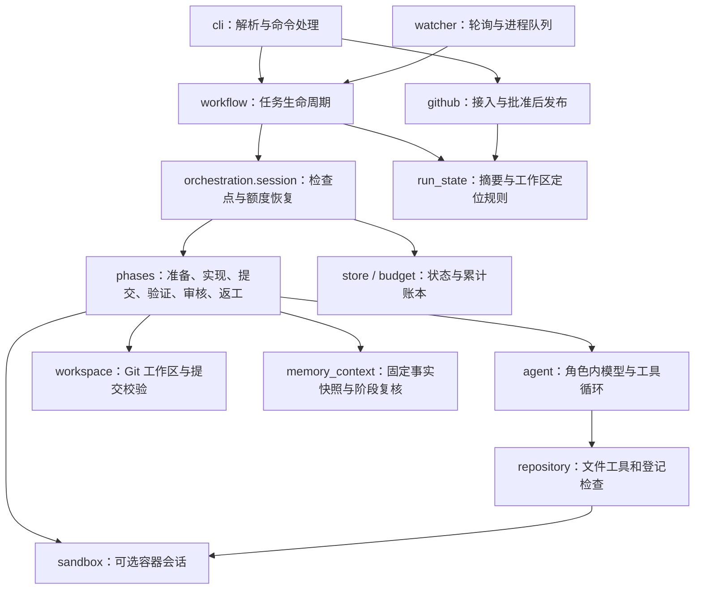

# 当前能力、实现结构与演进边界

截至 2026-10-18，RepoPilot 是面向可信本机仓库的 Issue 驱动研发运行时，支持默认本机和可选 Docker 执行后端。当前交付终点是人工批准后的 GitHub 草稿 PR；尚未覆盖原愿景中的自动合并和软件发布。本文描述实际代码，未来方向不视作已有能力。

## 原始需求对应到哪里

| 原始流程 | 已有实现 | 验证与边界 |
| --- | --- | --- |
| 以 Issue 触发 | 手动 URL 接入；按登记仓库、标签和创建时间轮询；队列去重 | 真实 Issue #1 手动接入，#3 自动接入；使用轮询，没有 webhook |
| 验证问题、确认需求 | 实现 Agent 读取需求和仓库、运行检查；结构化报告可说明阻塞和待确认问题 | 没有独立需求澄清阶段，也没有自动与 Issue 作者往返讨论 |
| 开独立工作区 | 固定基线提交，每次运行独立 Git worktree，核对原仓库与远端身份 | 本机 Git；不自动为各语言安装环境或依赖 |
| 写代码、测试 | 通用 UTF-8 文件工具、精确替换与写入、命名检查；限制编辑与调用次数 | 工具不依赖 Python AST；Python、JavaScript 小样例已验证，不代表所有语言生态都已验证 |
| 审核与返工循环 | 编排层独立重跑全部登记检查；只读审核 Agent；有限次返工并重新提交、检查和审核 | Docker 模式使用新容器复核，默认模式仍在本机；审核绑定提交，检查失败可否决模型批准；仍需要人判断需求和测试是否充分 |
| 中断后继续 | SQLite 状态、阶段检查点、显式恢复、重试留档、累计费用账本 | 阶段内部中断需要操作者核查；不逐条恢复模型会话，不提供跨机器恢复 |
| 人工审批 | CLI 批准或拒绝，绑定完整 SHA 及需求、验证、审核摘要 | 审批后版本变化失效；没有用户身份、RBAC 或审批网页 |
| PR 交付 | 批准后推送 feature 分支、创建草稿 PR；重复发布核对远端结果 | 真实 PR #2 已创建；审核通过本身不会自动推送 |
| 多 Issue 开发 | 持久化队列、有上限的 worker 进程池、同仓库限流、单任务锁 | 默认一个 worker；真实进程并发探针通过，未验证多个真实模型工单同时开发的效果 |
| 合并与发布 | 尚未实现 | 合并冲突、基线更新、重跑检查、新审批、CI 与发布策略都还需设计 |

当前真实证据是 [Issue #1](https://github.com/saikaji0314/zhixianji-jobs/issues/1) → [草稿 PR #2](https://github.com/saikaji0314/zhixianji-jobs/pull/2)，104 项独立检查、两轮审核及一次返工；[Issue #3](https://github.com/saikaji0314/zhixianji-jobs/issues/3) 经监听自动接入，93 项检查、两轮审核及一次返工后等待人审，未发布 PR。详情与失败尝试见 [VALIDATION-05](VALIDATION-05.md)。这些是开发复测，不能据此计算通用修复成功率。

## 这些概念实际做到哪一层

| 概念／技术 | 具体实现 | 尚未具备 |
| --- | --- | --- |
| Harness／轻量 AI 基础设施 | 宿主控制工具、状态、检查、预算、审批和发布；模型只提出受限动作与报告 | 面向不可信租户的隔离执行平台、分布式调度及服务运维体系 |
| LangChain／LangGraph | `create_agent` 承载单个角色内部的模型与工具循环；Pydantic 校验报告；DeepSeek 适配 | 外层业务流程是自定义 Python 状态机与 SQLite，未采用 LangGraph StateGraph／checkpointer |
| Multi-agent | 实现与审核两个角色，提示、工具权限、输出协议不同；默认使用同一可配置模型，顺序执行 | 角色独立不等于判断独立；没有多模型委员会或自由协商网络。多 Issue worker 并发属于任务调度 |
| Memory／上下文 | 当前上下文清理、宿主进度与状态持久化；可选跨运行文件事实书签，带提交来源、依赖指纹和人工生命周期 | 尚无任务经验归纳、长期语义检索、向量库或真实模型收益结论；检查点与文件事实分别管理 |
| 评测 | Fake／Mock 验证状态与边界；真实模型与 GitHub 开发复测；两个公开开发题可独立评分候选补丁，保留失败和费用证据 | 两题仅验证评分机制，尚无新版留出修复题集、重复模型实验和统计成功率。旧诊断题集不能直接当新版修复成绩 |
| 安全与可靠性 | 路径／链接约束、登记 argv、用量预留、版本绑定、锁与显式恢复；可选按阶段 Docker 隔离、禁网、资源与输出限额、停止后校验导入 | 工作卷磁盘配额、硬杀自动回收、更强虚拟机隔离、身份鉴权、不可篡改审计、完整提示注入防御；默认 local 检查仍有本机权限 |

“专项”已有较清楚的落点：**围绕可恢复、可审核、受预算约束的 Issue 到 PR 交付 harness**。评测、Memory、安全都有关联，但当前不能把三者均描述为深入完成的专项。下一步若要形成可比较的效果证据，应优先建立独立修复评测及失败分类，再按失败证据选择加强哪一层。

## 如何读代码



| 文件 | 职责与阅读重点 |
| --- | --- |
| [cli.py](../../repopilot/cli.py) | 参数解析、按命令加载凭证、调用应用操作、统一 JSON 与退出码；`main` 不承载整套业务 |
| [orchestration/workflow.py](../../repopilot/orchestration/workflow.py) | `create_job/start/resume/retry/decide/recover/snapshot`：任务身份、生命周期、审批与结果；入口协议保持兼容 |
| [orchestration/session.py](../../repopilot/orchestration/session.py) | `RunSession`：恢复计数与活跃时间、统一保存脱敏检查点；`execute_run` 调度阶段，集中映射错误状态 |
| [orchestration/phases.py](../../repopilot/orchestration/phases.py) | `PhaseRunner` 每个阶段一个方法；实现／审核载荷与结果转换分开，检查点由执行会话控制，固定基线仍在副作用前落盘 |
| [orchestration/state.py](../../repopilot/orchestration/state.py) | 终态集合、规范哈希、批准摘要、从持久化状态定位工作区；避免发布层依赖整套执行流程 |
| [agents/loop.py](../../repopilot/agents/loop.py) | DeepSeek 接线、结构化报告、上下文与进度中间件、角色内循环、独立检查入口 |
| [execution/repository.py](../../repopilot/execution/repository.py)、[execution/workspace.py](../../repopilot/execution/workspace.py) | 文件访问、受控命令、编辑限额；Git 基线、差异、提交、干净状态核对 |
| [execution/sandbox.py](../../repopilot/execution/sandbox.py)、[execution/transport.py](../../repopilot/execution/transport.py) | 阶段会话、Docker 生命周期、文件协议与登记检查；有界 CLI 传输，失败不回退宿主 |
| [execution/files.py](../../repopilot/execution/files.py)、[execution/worker.py](../../repopilot/execution/worker.py)、[execution/archive.py](../../repopilot/execution/archive.py) | 无模型依赖的共用文件规则；容器固定操作协议；完整校验后导入普通文件 |
| [storage/jobs.py](../../repopilot/storage/jobs.py)、[storage/budget.py](../../repopilot/storage/budget.py) | SQLite 状态与乐观并发、进程锁；模型费用预留、结算、共享累计上限 |
| [delivery/forge.py](../../repopilot/delivery/forge.py)、[delivery/github.py](../../repopilot/delivery/github.py)、[delivery/gitlab.py](../../repopilot/delivery/gitlab.py) | 平台识别、凭证路由与唯一的发布流程；GitHub／GitLab 各自的 REST 与 Git 差异，见[平台接入](FORGES.md) |
| [delivery/watcher.py](../../repopilot/delivery/watcher.py) | 轮询准入、按仓库来源选择平台、去重、worker 调度、停止与残留核查 |
| [core/config.py](../../repopilot/core/config.py) | 任务／检查／模型／限额协议、环境与执行 profile 校验 |
| [memory/store.py](../../repopilot/memory/store.py)、[memory/facts.py](../../repopilot/memory/facts.py) | SQLite仓库事实、人工确认／撤销／删除、有界检索；Git来源和文件／依赖指纹校验 |
| [memory/context.py](../../repopilot/memory/context.py)、[memory/cli.py](../../repopilot/memory/cli.py) | 运行开始冻结命中、阶段前复核、审核后收集候选；可信操作者管理入口，见[记忆协议](MEMORY.md) |

## 当前包结构与依赖方向

```text
repopilot/
  cli.py                 命令入口与参数，不承载业务流程
  core/config.py         任务、模型与执行后端契约
  orchestration/         workflow生命周期、session检查点、phases业务阶段、state版本规则
  agents/loop.py         模型适配、角色内工具循环与结构化报告
  execution/             文件工具、Git工作区、容器会话、传输和归档校验
  storage/               jobs状态与锁、budget累计费用
  memory/                事实存储、来源校验、阶段检索及管理入口
  delivery/              平台接入（GitHub／GitLab、草稿PR／MR）、监听与健康判断
  presentation/          只读报告装配、证据片段、格式化、概览布局与内联样式
  evaluation/            新版独立修复评分，属于当前实现
  legacy/                第一代Python诊断、AST检索和旧工具
  runtime/               历史导入与模块命令兼容，不再新增业务代码
```

依赖方向：CLI调用编排或交付操作；编排组合Agent、执行、存储和记忆；展示只读取状态与证据。新版不导入legacy。`core`保存契约，避免业务包互相定义重复配置；包拆分不引入微服务、RPC或新框架。

阅读一条交付链：`core.config.Task` → `cli._run_task` → `orchestration.workflow.start/resume` → `orchestration.session.execute_run` → `orchestration.phases.PhaseRunner` → `agents.loop.run_phase`，再看 `workflow.decide` 与 `delivery.github.publish`。报告入口为 `presentation.report`，片段、布局和证据格式分别在 `sections / layout / formatting`，不再由一个长函数同时处理整页。

`agents.loop`仍包含模型适配、中间件和报告协议；`delivery.watcher`仍同时包含队列与调度。持久化状态仍为字典。这些内聚代码本轮没有继续细拆或改写状态协议，避免把目录迁移扩大成行为重构。

## 新旧实现与迁移兼容

正式入口改为 `repopilot.cli:main`；旧的 `python -m repopilot.runtime.cli` 保留兼容。历史 `repopilot.runtime.<模块>` 映射到同一个实际模块对象，而非复制实现，避免两份模块状态或 monkeypatch 分叉。新代码及仓库内调用方使用实际包路径。兼容层集中在runtime的短映射表，后续新模块不继续登记旧别名。

第一代源码统一移入 `repopilot.legacy`，内部导入与维护脚本已迁移；旧Python导入应改用 `repopilot.legacy.*`。0.1.0rc1起wheel仅安装新版`repopilot`命令，旧基线需要完整源码与题集，调用方式见[历史说明](../legacy/README.md)。升级现有checkout后重新执行可编辑安装以更新命令入口。新版独立修复评测 `repopilot.evaluation` 不属于legacy。

外部任务YAML、状态字段、SQLite数据库、运行ID、预算、活动配置、`.local`目标仓库和worktree路径不迁移。旧产物中的源码位置代表当时版本，不批量改写历史证据。旧题集和报告保留原目录，旧说明见[历史实现](../legacy/README.md)。两版仍共用一个发行包和依赖，尚未拆分optional dependencies；不把目录分开等同于独立发布产品。

## 尚待打磨的交付效果

当前终点保持草稿PR，CI/CD扩展已暂缓，见[交付边界](DELIVERY-POLICY.md)。当前最明显差距是长期运行与效果验证：监听尚无系统服务、自启、崩溃自恢复或长期压测；`watch --status` 已按时间区分新鲜与过期心跳，但新鲜心跳仍不能证明进程身份及整体健康，须结合PID、锁与日志判断。独立评分最小骨架见[两题开发评测](../../evals/repair/README.md)，不能把控制补丁得分当作模型修复成功率。

后续可按验收收益依次处理：独立修复题集与失败统计；监听健康判断和服务部署；多候选基线变化与冲突协调；接入 CI 与合并策略。长期 Memory 或更强隔离应由真实失败及部署需求驱动，而不是同时扩展所有方向。当前范围的展示方法见 [DEMO](DEMO.md)，本次结构调整验证见 [VALIDATION-06](VALIDATION-06.md)。

上述方向的分阶段候选方案、Memory使用位置、沙箱边界、评测协议及合并发布门见[后续设计](NEXT.md)。[Docker 后端](SANDBOX.md)已接入运行时，Python／Node 真实容器与确定性模型流程验证见 [VALIDATION-11](VALIDATION-11.md)；尚未在该后端验证真实模型交付效果。


当前设计选择、替代方案与逐模块阅读任务见[设计取舍与代码阅读](DESIGN.md)；展示与本次分包验证见[VALIDATION-12](VALIDATION-12.md)。
