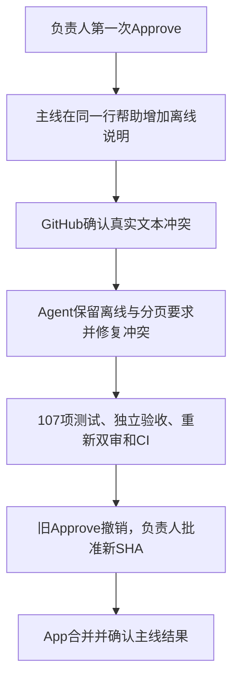

# 五分钟看懂一次交付

先看[报告动图](../demo/README.md)，再打开[分页PR #7](https://github.com/saikaji0314/zhixianji-jobs/pull/7)。这是已经结束的真实交付，下面按讲解顺序解释证据，不会再次调用模型。

## 1. 需求是什么

用户需要在本地批次列表中用`limit／offset`分页。命令只读本地数据，不访问网站。需求、冻结检查和历史章节保护都在执行前登记，模型不能修改外部独立验收来放行。

## 2. Agent做了什么

先形成计划，在独立worktree实现CLI、存储查询、测试与文档。编排层独立执行104项测试和黑盒验收；正确性与需求上下文两个只读审核视角核对同一提交。首轮发现新增标题打断旧文档章节，返工一次后重验和双审通过。

## 3. 人决定什么

负责人核对报告并批准完整候选SHA，App才推分支并创建草稿PR。负责人随后在GitHub转为Ready for review，对同一提交点Approve。这两次批准用途不同：一次允许提交PR，一次允许合并。

## 4. 程序如何确认交付

RepoPilot前台检测核对当前SHA的负责人review、必需`offline`检查与分支保护，再由App提交合并。它等待远端确认，并检查原候选、基线和合并提交的祖先关系，最后保存`merged`结果。重复核对复用同一结果，不再调用模型。

正常合并本身不调用模型。若主线改变，基线更新和冲突修复可能需要模型，并继续占用原运行的额度；更新代码后需要重新检查、双审和负责人对新SHA的Approve。

## 5. 讲清楚失败与限制

成功尝试72次请求、约4.79元。此前规划失败用了66次请求、约2.92元，两个尝试合计约7.71元。不要只展示成功费用。这个样本验证正常合并，真实冲突也已用小型帮助任务完成验证，详情见本页追加演示及[验证总览](../VALIDATION.md)。复杂任务、复杂冲突和通用成功率仍不能据此承诺。

## 自己复现

安装和首个本地任务见[项目首页](../../README.md#快速开始)，接Issue见[平台接入](FORGES.md)，App及原生Approve见[App配置](GITHUB-APP.md)与[合并协议](MERGING.md)。用已有运行生成报告或动图见[展示素材说明](../demo/README.md#用自己的运行生成回放)。真实新任务会产生模型API费用；读取已结束的报告不会。

## 追加演示：真实冲突如何处理

[帮助任务PR #9](https://github.com/saikaji0314/zhixianji-jobs/pull/9)只补CLI帮助文字，用同一行改动制造真实冲突，避免把测试题本身做复杂。

整轮56次模型请求、92次工具执行、估算2.78元。重新审核保留原来两条轻微文档计数建议，程序依既定minor不阻断规则整体通过；原始两个视角的修改意见没有被改写成批准。合并提交是`6c510e43f4c3fee7619c6acb98708449f640cb42`，原功能提交和主线测试提交均包含在结果里。这个样本证明该简单冲突路径，不代表复杂业务冲突都能自动解决。[完整记录](../VALIDATION.md#帮助任务的真实冲突验证)
