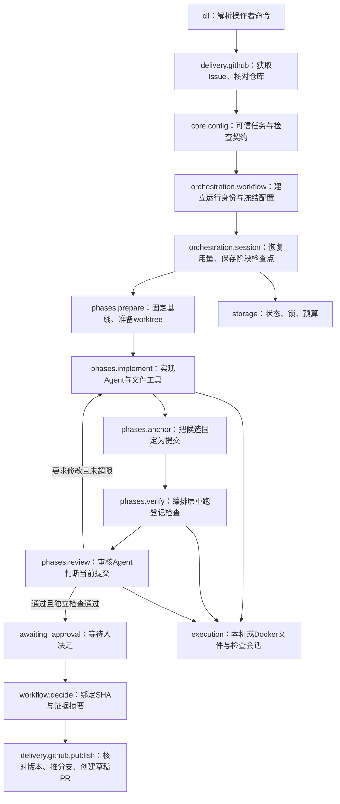

# 设计取舍与代码阅读

本文解释当前实现的职责与取舍，不把选用某项技术等同于它优于所有替代方案。功能边界见 [ARCHITECTURE](ARCHITECTURE.md)，运行契约见 [运行协议](README.md)，近期交付终点为草稿 PR。

## 先跟一条交付链

图中的实现与返工使用同一个实现入口，但报告、累计次数和历史都需要保留。检查失败时，编排层不会只因模型说“通过”就放行。未实现、需澄清、超限、中断、审核无法判断等状态并不沿成功路径前进，具体分支由状态机与契约控制。

## 两层循环各负责什么

**角色内循环**在 [agents/loop.py](../../repopilot/agents/loop.py) 的 `run_phase`：模型选择工具，读取观察，再选择工具或提交结构化报告。LangChain `create_agent` 承载这一层，底层使用 LangGraph 的 Agent 执行机制。

**业务阶段循环**在 [orchestration/session.py](../../repopilot/orchestration/session.py) 的 `execute_run` 与 [phases.py](../../repopilot/orchestration/phases.py)：决定是否提交候选、独立验证、审核、返工、暂停。它还要处理真实副作用、累计额度和审批约束。这一层当前是显式 Python 状态机与 SQLite。

两者服务不同职责。例如，模型返回 implemented 只是一个输入报告；它不能自己授予 GitHub 发布权限，也不能把预算恢复为初始值。是否继续由控制面核对实际改动、检查与审核结果。

## 当前方案与可替代方案

| 决定 | 为什么当前这样做 | 替代与重新选择条件 |
| --- | --- | --- |
| LangChain Agent 内循环 | 复用模型消息、工具协议和结构化报告接线，保留自定义用量／进度中间件；版本固定以减少接线漂移 | 手写循环可减少框架依赖，但要自行维护消息配对、工具协议和模型差异；不是天然更简单 |
| 外层显式状态机 | 当前阶段有限，阶段、错误、真实副作用和落盘点可以直接对应；已有恢复与审批测试覆盖 | 可以改为 LangGraph StateGraph／checkpointer；框架也支持持久化，但迁移仍需定义Git/GitHub副作用的幂等及审批规则，不是换框架即自动解决 |
| SQLite 与本机文件锁 | 对当前单机、低并发执行部署简单；任务版本校验拒绝过期写入，数据库事务管理竞争 | 多机器执行或持续高写入竞争时，应考虑服务化数据库和调度；当前不声称分布式可靠性 |
| 人工请求与任务同检查点保存 | 请求、答案和阶段一起更新，避免分库半次保存；需求补充、批准、恢复共用记录而保留各自条件，等待不占模型循环 | 独立请求服务适合多机／多渠道，但仍需解决请求版本和任务状态一致性；本地协议见[人工协作](HUMAN.md)，平台评论尚未接入 |
| 版本化正文＋SQLite派生索引 | 原文和历史可读，改删局部同步；确认与运行清单绑定版本，缺失／变更不能静默放行；人工事件派生产物可幂等补齐 | 向量／图服务可在检索缺口或规模需要时另接，不替代来源与确认；索引不是第二份可独立编辑正文，详见[资料管理](KNOWLEDGE.md) |
| 每次运行独立 Git worktree | 固定提交并共享对象库，不直接改用户工作目录；便于采集差异和绑定候选 SHA | clone 隔离 Git 配置更彻底但成本更高；worktree 共享对象与配置，不能当 OS 沙箱 |
| 登记检查 argv | 操作者决定命令与工作目录，模型只能按名称请求；避免Issue文本直接改执行配置 | 任意 shell 更灵活，但扩大权限和审核范围；即使命令已登记，仓库检查代码仍需受信或进入隔离环境 |
| 独立重跑检查与审核角色 | 不以实现方的自评代替真实退出结果；审核围绕需求、差异、固定提交与检查事实提出返工 | 同一模型分角色不保证判断独立；当前登记测试也不是隐藏验收。真实效果仍需独立题集和实验 |
| 可选普通 Docker | 文件工具与检查统一进入容器，凭证留控制面，停止后校验普通文件再导入 | 裸进程不能提供同等OS边界；microVM／更强隔离可能适合不可信worker，但当前本机Sandboxes前提失败。磁盘配额和硬杀回收仍缺失 |
| SHA 与证据摘要绑定审批 | “同意发布”只对具体需求、基线、提交与审核证据有效，避免批准后静默更换内容 | 简单 approved 布尔值无法说明批准了哪个版本；新的审批／变更策略需要同时定义失效规则 |
| 文件事实记忆 | 用提交、文件指纹、来源和人工生命周期提高可追溯性；先解决事实失效，再讨论召回规模 | 向量或混合检索适合更大知识量，但不替代来源验证；当前无真实模型收益对照结论 |
| 轮询与有界进程池 | 先覆盖少量已登记仓库，部署依赖少，等待审批不占worker | Webhook、队列服务和远程worker适合更大规模；仍要处理幂等、认证、任务锁与恢复 |
| 单文件只读 HTML | 让无模型权限、无服务端环境的人查看一次运行，离线分享；不维护另一套仓库管理平台 | 实时控制台需要持续服务、鉴权与写操作规则；当前未纳入范围，GitHub仍负责仓库协作 |
| legacy 集中、runtime 兼容 | 区分新旧职责，维护旧题集与脚本；旧runtime名指向同一模块对象，避免两份状态 | 直接删除会破坏历史复现；长期仍可独立拆包、弃用兼容层，但需另外定义迁移窗口 |

这些是当前规模下的工程选择，并非不可更改的结论。是否替换技术应由明确的失败、维护成本或部署要求决定。

## 逐模块阅读任务

每次选择一行，完成“解释职责 → 跟踪真实数据 → 说明失败分支 → 修改小行为并验证”，再进入下一层。

| 顺序 | 代码入口 | 应能回答的问题 | 对应验证 |
| --- | --- | --- | --- |
| 1 | [cli.py](../../repopilot/cli.py)、[workflow.py](../../repopilot/orchestration/workflow.py)、[phases.py](../../repopilot/orchestration/phases.py) | 需求从哪里来，阶段由谁推进；模型的 implemented 为什么不是最终结果？ | [review_loop](../../tests/runtime/test_review_loop.py) |
| 2 | [core/config.py](../../repopilot/core/config.py)、[agents/loop.py](../../repopilot/agents/loop.py)、[reports.py](../../repopilot/agents/reports.py) | 工具如何交给模型；结构化输出解决什么，不能解决什么？ | [agent](../../tests/runtime/test_agent.py)、[report_contract](../../tests/runtime/test_report_contract.py) |
| 3 | [execution/repository.py](../../repopilot/execution/repository.py)、[files.py](../../repopilot/execution/files.py)、[workspace.py](../../repopilot/execution/workspace.py) | 文件权限、编辑额度与Git工作树隔离的边界分别是什么？ | [repository](../../tests/runtime/test_repository.py)、[workspace](../../tests/runtime/test_workspace.py) |
| 4 | [execution/sandbox.py](../../repopilot/execution/sandbox.py)、[transport.py](../../repopilot/execution/transport.py)、[archive.py](../../repopilot/execution/archive.py) | 为什么停止代码后才能导入；输出、归档、磁盘三个限额有什么差别？ | [sandbox](../../tests/runtime/test_sandbox.py) |
| 5 | [orchestration/session.py](../../repopilot/orchestration/session.py)、[storage/jobs.py](../../repopilot/storage/jobs.py) | 阶段内崩溃与阶段后暂停有什么不同；in_flight、锁、revision分别管什么？ | [workflow](../../tests/runtime/test_workflow.py) |
| 6 | [storage/budget.py](../../repopilot/storage/budget.py)、[RunControl](../../repopilot/agents/loop.py) | 为什么调用前预留费用，未知费用为什么不能重置为零？ | [budget](../../tests/runtime/test_budget.py) |
| 7 | [workflow.decide](../../repopilot/orchestration/workflow.py)、[delivery/github.py](../../repopilot/delivery/github.py) | 批准后代码、Issue或基线变化时为什么拒绝发布；响应丢失后如何避免重复PR？ | [github](../../tests/runtime/test_github.py) |
| 8 | [memory/context.py](../../repopilot/memory/context.py)、[facts.py](../../repopilot/memory/facts.py)、[store.py](../../repopilot/memory/store.py) | 检查点、日志、源码和跨任务记忆为何不是同一件事？ | [memory_integration](../../tests/runtime/test_memory_integration.py) |
| 9 | [delivery/watcher.py](../../repopilot/delivery/watcher.py)、[queue.py](../../repopilot/delivery/queue.py)、[health.py](../../repopilot/delivery/health.py) | 一项Issue被扫描多次、进程退出或等待审批时，队列怎么变化？ | [watcher](../../tests/runtime/test_watcher.py) |
| 10 | [evaluation/grading.py](../../repopilot/evaluation/grading.py)、[cases.py](../../repopilot/evaluation/cases.py) | 机制测试、真实模型效果和独立补丁评分分别证明什么？ | [grading](../../tests/evaluation/test_grading.py) |
| 11 | [presentation/report.py](../../repopilot/presentation/report.py)、[sections.py](../../repopilot/presentation/sections.py)、[layout.py](../../repopilot/presentation/layout.py) | 展示从哪里读取事实，如何避免把缺失、历史或模拟结果展示为成功？ | [report](../../tests/runtime/test_report.py) |
| 12 | [runtime/__init__.py](../../repopilot/runtime/__init__.py)、[历史实现](../legacy/README.md) | 为什么保留旧导入，但新代码不能依赖legacy？ | [architecture](../../tests/runtime/test_architecture.py) |

阅读文档、运行已有测试和能独立解释／修改是不同程度的掌握，不能混为一项已完成记录。
