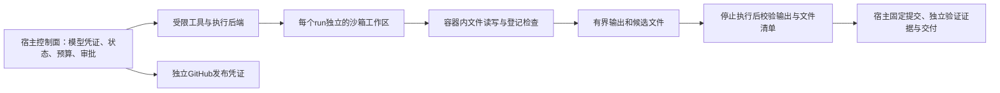

# 后续设计：记忆、隔离、评测与交付

更新：2026-10-17。**本文件是候选实施方案，除下方进展注明的项目外均未实现。** 当前事实以 [ARCHITECTURE](ARCHITECTURE.md) 和各次验证记录为准；当前终点仍是人工批准后创建草稿 PR。

后续进展：阶段A已增加心跳过期判断和[两题独立评分骨架](../../evals/repair/README.md)。这两个公开开发题只验证评分机制；12题和留出评测仍未实现，其他阶段边界见下方进展说明。

阶段B已接入[可选仓库文件事实记忆](MEMORY.md)：Git来源、依赖指纹、有界关键词检索、固定运行快照与人工确认候选。以下关于任务经验、长期语义检索及真实模型效果实验的方案仍未完成；机制验证见[VALIDATION-08](VALIDATION-08.md)。

目标是逐步完成“可靠处理多个仓库的 Issue，并交付有证据、可审核的改动”。Memory、沙箱、评测和展示围绕这条主线建设，每个增量必须有独立验收。先完成小规模可比较实验和一个可演示闭环，再扩语言、并发与部署范围。

## 1. 顺序与完成条件

| 阶段 | 最小交付 | 进入下一阶段前的验收 |
| --- | --- | --- |
| A：运行健康与评测基线 | 心跳过期判断、结构化状态；新版修复题集与独立评分器 | 正常／过期／中断可区分；已知坏补丁不能通过独立评分；完整保留失败分母 |
| B：仓库记忆 | 仓库事实与验证过的任务经验；带来源、作用域和失效规则的有界检索 | 不串仓库、不泄漏答案、不继承旧审批；冷／热运行及失效案例可复现 |
| C：隔离执行 | 可替换执行后端；Python、Node 的 Docker 验证配置 | 文件、网络、凭证及资源限制探针通过；两类语言运行同一工具协议，无静默退回宿主 |
| D：展示 | 脱敏运行报告、真实链路录屏、可选只读控制台 | 从 Issue 可追到补丁、检查、返工、审批与 PR；失败或等待审批有清楚展示 |
| E：审批后合并 | 获取 CI、固定版本校验、基线更新与重新审批、幂等合并协调 | CI失败、SHA变化、基线变化、异步操作超时都不会误合并 |
| F：发布候选 | 固定合并提交构建制品、独立发布审批、GitHub Release、回滚演练 | 发布同一已验证制品，重试不重复发版；失败可定位和恢复 |

先完成 A→B 的效果证据，C 的环境预检可以提前做；A/B/C 形成第一轮新展示。E/F 是第二轮闭环，不作为首轮 Memory 或 Docker 的附带功能。只读报告可以贯穿各阶段生成，不必等所有功能完成才展示。

## 2. Memory：记什么、谁读取、何时失效

记忆需要减少重复调查，同时避免把旧结论当成新事实。任务状态、日志、代码索引和跨任务记忆分别管理：状态用于恢复，日志用于追溯，索引用于定位当前源码，记忆保存经过验证且可复用的事实或经验。

### 分层与使用位置

| 层次 | 内容与来源 | 读取时机与边界 |
| --- | --- | --- |
| 运行内工作记忆 | 当前需求、调查摘要、已读／编辑路径、检查结果、未决事项 | 实现每轮、返工和恢复；仅本 run，不自动推广到长期记忆 |
| 仓库事实 | 模块入口、目录职责、构建方式、已登记检查的说明、源码证据、人工确认的约定 | 工单接入后按涉及模块检索；实现和审核都可读，必须回到当前代码核对 |
| 任务经验 | 已验证问题的触发条件、涉及模块、处理方式、验证方法；已确认的失败原因 | 实现启动或遇到相似错误时检索；成功与失败分别标记，失败不能伪装成推荐方案 |
| 组织规则 | 可改路径、命令登记、审批规则、发布配置 | 始终来自可信配置与版本化规则；不是模型可改写的记忆 |

例子：第一次调查得知 batches 的 CLI 在某文件、查询在另一文件、边界测试在第三处；下次相邻需求可以从这些入口开始。记忆不能让 Agent 跳过读取当前版本、独立检查，或照搬上次的 SQL 补丁。生产数据、账号信息、完整会话和原始思考不进入记忆。

审核角色默认只拿仓库事实、当前需求、候选差异和独立检查。它独立判断，不自动继承实现方的“已经正确”叙述；确需参考历史经验时，明确显示来源和可能失效，不能继承此前批准。

### 数据和生命周期

建议一个持久化记录包含：`id / kind / namespace / repository_id / module_paths / content / source_run / source_commit / evidence_refs / dependency_fingerprints / validation_status / created_at / validated_at / expires_at / supersedes`。namespace 至少区分组织与仓库，run 内记忆另加 run_id；仓库身份来自登记配置和远端核对，不能由 Issue 文本决定。

写入过程：`候选 → 来源和脱敏校验 → 待验证 → 已验证 → 过期／被替代`。模型可以提出候选，但宿主校验来源、范围和体积；不得直接修改可信检查、审批或发布策略。独立检查通过但尚未合并的经验保留候选身份，不能把“模型审核批准”直接升级为长期正确知识。人工确认事实、合并后重验的成功经验可晋升；失败经验则记录确证失败与适用前提。

读取按仓库、模块、错误类别和版本过滤，再排序，首版限制最多5条、合计约6KB，记录取回ID、筛选原因和是否实际引用。工具返回内容作为参考数据，不拼成高优先级指令。相关文件或锁文件变化、来源不存在、超过有效期、与新证据矛盾时，应重验、降级或停用；不要在任何提交变化后全部失效，也不能只靠TTL判断新鲜度。

运行开始固定本次可见记忆版本并记录快照；进行中的并发任务不会因为另一任务写入而悄悄改变上下文。操作员应能查看来源、撤销、删除和重建索引；删除后不得从事件重放自动复活。跨仓库共享默认关闭。

### 技术取舍与证据

先沿用 SQLite 保存领域记录，按结构化过滤与关键词检索，提供小型 MemoryStore 接口及无记忆开关。namespace／key／JSON 文档组织可对接 LangGraph Store；多机器时再考虑持久化服务。引入 Store 不要求重写现有外层状态机。LangGraph 官方区分线程内状态与跨线程 Store，本方案借用这个边界，并不声称当前已有长期记忆。[Memory 概念](https://docs.langchain.com/oss/python/concepts/memory)、[Store 接口](https://reference.langchain.com/python/langgraph.store/base)。

首版不另起向量数据库或引入 embedding 费用；只有关键词检索在固定任务上漏检且影响成功率，才对比向量／混合检索。是否保留 Memory 由冷／热任务对照决定：检查成功率、重复读取、模型调用、Token、耗时和陈旧记忆误用，而不只演示“存了一条又读出来”。

## 3. OS 沙箱：控制面保留在宿主，仓库执行进入隔离环境

当前 `run_check` 在本机调用登记 argv，文件工具也操作宿主 worktree。因此新增后端不能只是在某处套一个 docker命令，就宣称支持不可信仓库。

目标边界：

引入一个明确的执行会话抽象：准备工作区、文件读写／搜索、执行登记检查、收集结果、停止与清理。保留 `local` 后端用于已信任仓库，新增 `docker` 后端；配置指定后端，预检失败即停止，不自动退回宿主。工具协议和输出报告保持一致。

候选后端包括普通 Docker 容器和 Docker Sandboxes 的每任务 microVM。已按操作者授权安装独立 `sbx` 并启用 Windows 虚拟化；2026-10-17 的 Windows 原生 `v0.48.0` 探针在内部 socket 上失败，尚未创建沙箱，见[真实验证记录](VALIDATION-09.md)。因此暂不把 Sandboxes 接入标为完成，也不因诊断健康就跳过实际执行验证。后续在 Linux／WSL2 继续验证 Sandboxes，或改验 Docker Desktop 的 Linux 容器后端，须先通过关键依赖探针再实现产品适配。

实现不假设所有语言都能在 Linux 构建。Windows 原生工程及其他特殊环境需要单独适配，尚不承诺“任意仓库无配置可运行”。Docker Desktop 的 WSL2 模式及其隔离边界见[官方说明](https://docs.docker.com/desktop/features/wsl/)。下面的容器限制是候选配置；microVM 后端需要按其实际权限模型单独验收，不能把非 root／只读根等要求直接宣称为 Sandboxes 默认行为。

### 首版隔离配置

- 每个 run 独立工作目录／卷。只传递固定提交的源码快照与声明输入；不挂载宿主仓库根目录、`.git`、`.local`、home、`.env` 或 Docker socket。
- 模型与 GitHub 凭证留在宿主控制面，容器只接收工具所需内容；模型调用由宿主发起。
- 非 root 用户、只读根文件系统、显式可写源码卷和有大小限制的临时空间、删除 capabilities、no-new-privileges，保留 seccomp 默认防护；禁止 privileged、host PID／network。
- 默认禁网。依赖预装在固定镜像；确需下载时使用单独、受控的依赖准备阶段并锁定产物，不能给任意测试命令长期开放外网。容器内可按配置使用临时测试服务，不等于允许公网出口。
- 显式限制 CPU、内存、进程数、执行时间、输出量与磁盘占用。磁盘限制取决于后端能力，需要实际验证，不能仅凭某个flag假定生效；输出应流式计数并在达到上限时停止收集或终止。
- 宿主导入前停止仓库代码执行，按允许的普通文件清单检查路径、链接、体积和权限；拒绝越界归档与特殊文件。宿主 Git 操作禁用仓库钩子及非必要外部程序／过滤器，不在不可信目录内启动任意命令。

Docker 默认并不限制资源，容器也不是虚拟机级的完整边界；限制须显式配置并以探针验证。未来若要接不可信外部仓库，再评估专用 Linux worker、rootless、gVisor／独立虚拟机等更强隔离；不把这些作为当前必装组件。[Docker 安全](https://docs.docker.com/engine/security/)、[资源限制](https://docs.docker.com/engine/containers/resource_constraints/)、[rootless](https://docs.docker.com/engine/security/rootless/)、[seccomp](https://docs.docker.com/engine/security/seccomp/)。

### 接入与验收

可先把登记检查接入容器，作为受控可信仓库的过渡增量；直到文件工具与工作区也进入沙箱、结果导入验证完成，才宣称具备完整容器执行后端。实现、返工、独立验证必须使用同一镜像摘要与环境配置，避免只隔离模型自测、宿主复核仍裸跑。

验收至少覆盖：正常Python／Node检查；无法读取宿主凭证诱饵与另一run文件；外网出口被拒绝；无限循环／大量子进程／过量输出被限制；OOM与超时正确分类；停止后子进程结束；异常时清理有界且不会删除共享账本。路径、资源上限、镜像digest及探针结果进入验证证据。

## 4. 评测：测补丁、测编排，也测交付门

当前324项回归证明程序行为，两条真实开发工单证明局部闭环；两者都不足以回答“整个系统可靠程度是多少”。新版评测分层：

| 层次 | 测什么 | 判定来源 |
| --- | --- | --- |
| 确定性契约与故障测试 | 状态转换、额度、锁、恢复、重复请求、过期审批、漏检查、API中断 | Fake模型／Mock API＋真实本地Git，按不变量断言 |
| 沙箱与资源探针 | 越界、串任务、网络、凭证、进程和输出限额 | 实际隔离环境与探针退出结果 |
| 修复效果评测 | 是否解决需求、是否破坏原行为、补丁质量 | Agent不可见的独立验收＋原回归；人工抽审 |
| 交付演练 | Issue入队、审批暂停、PR、CI、合并与发布恢复 | 隔离的演示仓库与真实平台记录，按已实现阶段验收 |

### 题集与判定

先建12题：6题开发集＋6题冻结留出集，Python与JavaScript各覆盖两类集合；需求包括缺陷修复、小功能、跨文件改动及应当拒绝／澄清的工单。最初使用最小夹具与Flaskr，真实仓库补充来源清楚的案例，Flask较大仓库作为后续扩展集。已有工单和旧诊断题只能作开发材料或经重新建模的题源，不能假装留出；保留真实需求与受控注入的类别标记。

每题固定仓库SHA、Agent可见Issue、可信检查配置、环境／镜像版本、隐藏验收及来源。先确认干净基线、缺陷触发或功能未满足，再运行候选补丁。缺陷题要求关键检查从fail到pass，原有pass检查继续pass；功能题要求新行为与边界通过，并保留旧行为。

评分器从干净基线重建工作区，只应用候选补丁，在Agent不能编辑的环境执行隐藏验收。修改／删除测试、改检查登记、伪造输出不能获得通过；合法修改公开测试本身可允许，但仍必须过独立验收。参考补丁和隐藏断言不进入模型工具、Memory、工作区或可检索的本机日志。若工具仍能执行宿主任意代码，不能声称隐藏答案已形成安全隔离，应先限定可信夹具并标注此限制。

应用补丁后用独立测试评分可参考 [SWE-bench evaluation](https://www.swebench.com/SWE-bench/guides/evaluation/)，但首版不直接跑完整SWE-bench，也不把自建成绩当作该基准成绩。

### 指标、实验和预算

主指标为独立验收通过率；拆出完整交付率、回归破坏率、人工拒绝率、澄清是否恰当。伴随指标包括模型／工具调用、读文件重复率、Token与估算费用、活跃执行与等待耗时、审核发现的真实问题、恢复成功率、重复副作用数量。报告区分 solved、unsolved、blocked、needs_clarification、budget_limit、model_error、environment_error、policy_violation，不能只报告“流程completed”。

成功率分母保留所有预登记尝试，环境失败和超限单列；可另报“已完成评分样本”的条件结果，但不可替换全样本分母。报告单次上限、实际／估算费用与未知用量预留；不同run共享既有累计预算，不创建新目录绕过限额。每次实验另设预算上限，并根据账本当前余量核算，不将历史估算当账户余额。

第一轮先跑6题开发集摸底，冻结模型、提示、运行时代码、profile、工具、环境与任务版本后，再运行6题留出集。只改变一个主要因素，保留无审核／有审核、无记忆／有记忆的对照能力；不在同一次实验同时改模型和Memory后宣称Memory提升。

Memory实验使用相关但不同的任务序列：预先固定可学习的训练任务及记忆快照，评测新任务。各实验臂从同一预算条件与可见知识起点出发，分别保存账本关联与记忆版本；留出集的答案和此前解题结果不进入后续留出任务记忆。另设单独的“持续学习”实验，才能允许顺序积累，且明确标注协议。

预算允许时选代表任务重复2–3次，顺序交替，报告波动与全部失败。不要用6次开发复测给出稳定成功率或统计显著性结论。若Memory未减少成本、未改善成功率或增加误用，保留开关并缩小范围，不为已有代码辩护。

## 5. 展示：让观众看到一次交付的证据

先做脱敏、可离线打开的HTML／Markdown运行报告，再决定是否增加实时界面。报告从状态和结构化产物生成，不展示原始模型思考或完整私密对话。建议包含：需求与仓库基线、阶段时间线、补丁、独立检查、审核与返工、人工决定绑定SHA、远端链接、费用及最终状态。Memory部分显示来源与命中、沙箱部分显示配置摘要及探针结果；计划能力不伪造成已有事件。

展示分三层：

1. 90秒概览：输入工单、产出补丁、检查和人工门、最终PR，说明仍有什么需要人。
2. 5–8分钟实证：真实成功路径，加一次审核返工或失败／恢复；指向可核对记录。
3. 可复现材料：小型离线任务、命令、版本、报告及必要公开测试。首次观看无需真实token，也不产生模型费用。

实时控制台留到状态和事件接口稳定之后：先只读任务列表、心跳新鲜度、阶段、用量和证据，避免把一次性演示变成前后端大项目。网页审批涉及身份、CSRF及权限，不能直接暴露现有同用户CLI决定；新增网页审批应单独验收。录屏中的已有结果须标为历史回放，实时接单另标为实时，不能把旧心跳当作监听在线。

## 6. 合并与发布：三个决定分别记录

当前的 `approve` 只授权指定提交创建草稿PR，**不能继承为允许合并或允许部署**。扩展应增加不同动作的批准记录，每条绑定对象、版本、证据摘要、操作者、理由和时间。

### 合并流程

`published → 检查PR与CI → 评估目标分支变化 → integration_verified → awaiting_merge_approval → merging → merged`，另有 `stale / conflict / ci_failed / merge_failed` 等明确状态。具体状态名在接口实现前冻结，不直接修改旧记录或把它们当成已经支持。

- 拉取PR head和目标branch SHA，核对仓库、Issue、候选版本、非draft状态、独立检查、要求的CI及审核。CI必须对应当前候选或平台生成的实际合并结果，旧提交绿灯不能复用；未知／缺失／超时不是通过。
- 为小规模场景先串行合并，同仓库默认仍一次一个候选进入合并门。基线变化后在新隔离候选中更新／重做集成验证，不reset或偷偷改写已批准工作树；发生冲突暂停或进入有次数上限的新修复尝试。
- 任何候选内容／head变化都重新检查、审核并取得新版本的发布／合并授权。即使head未变，目标branch变化也必须使旧集成证据失效；初版保守要求重验和新合并批准。
- 配置GitHub分支保护或ruleset及必需CI，让平台共同约束最终竞态；客户端前后两次GET不能原子锁住远端base。需要高并发时使用平台merge queue，验证临时合并结果，不自行实现分布式锁来假装解决远端竞态。
- 合并请求携带预期head SHA，不绕过规则。当前官方推荐异步合并接口，未来适配记录操作UUID；accepted／enqueued不能记作merged，需轮询实际结果并记录最终merge SHA，超时后先查询再重试。[合并API](https://docs.github.com/en/rest/pulls/pulls#merge-a-pull-request-asynchronously)、[分支保护](https://docs.github.com/en/repositories/configuring-branches-and-merges-in-your-repository/managing-protected-branches/about-protected-branches)。

异步操作记录过期或无法查询时，先核对PR最终状态与合并提交，再决定恢复；不能因为轮询丢失就重新发起副作用。平台接受的skipped／neutral检查状态，也不能自动代替本项目要求的独立业务验收；允许跳过的检查必须预先登记条件。

远端授权与本地审核身份需明确：首版可用CLI显式操作者记录结合GitHub令牌身份，之后扩为GitHub App／组织身份；不能称为完整企业RBAC。自动合并仅在仓库负责人登记策略、平台保护和验证充分后再考虑，默认仍需要人决定。

### 发布流程

第一种发布目标先选 **GitHub Release＋构建制品**，不默认承担任意语言服务部署。每个仓库用可信release profile登记构建命令、产物、版本策略和smoke check；部署适配器之后按仓库需要加入。

`merged → build → smoke_verified → awaiting_release_approval → releasing → released`。发布批准绑定最终merge SHA、制品digest、版本号与目标环境；构建一次，批准后发布同一制品，避免批准后重新构建产生新内容。标签指向已验证提交，制品名或版本冲突应核查，禁止静默覆盖。

CI负责构建、签名／制品记录与环境发布；RepoPilot负责请求、门禁、状态与证据，不让模型自由操作部署凭证。可利用GitHub Environments保护发布门，但功能取决于仓库可见性及套餐，实施前须核对；不可用时保留明确CLI批准。[Environments](https://docs.github.com/en/actions/how-tos/deploy/configure-and-manage-deployments/manage-environments)。

幂等键至少包含仓库、版本、目标提交和制品digest。发布中断先查询现存release／产物再恢复；发布失败不反向假装代码未合并。回滚应重新发布已验证的上一制品或建立revert PR；代码、制品和带数据库迁移的运行服务分别设计，不能承诺一条Git命令通用回滚。

## 7. 接下来第一个可实施增量

选择阶段A的小闭环：**监听健康可辨认＋新版独立修复评测最小骨架**。先用2个公开开发任务验证“基线未满足 → 候选满足 → 坏补丁仍失败”，再补齐12题清单，确认评分不会采信模型自报和可改测试。

同时只定义Memory记录与读取边界，不先安装向量服务；只做Docker环境预检与接口草案，不先跑大批量真实模型。第一轮实验与软件安装的实际范围、预算和发布对象在实施时确认，本文不自动触发新监听、付费评测、系统安装或远端合并发布。
