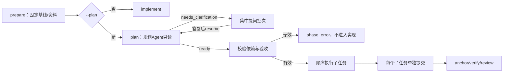

# 任务说明、计划与子Issue

更新：2026-10-27。范围：单仓库父任务默认先整理任务说明与顺序子任务，集中提问计数，以及按需把子任务映射到父Issue评论／子Issue。当前只验证本地机制和模拟平台协议；没有真实模型规划效果或真实平台写入结论。

## 为什么先加这一层

原实现能接收Issue或本地需求、在独立worktree实现和审核，但“需求到底要满足什么、要不要拆、先后做什么”只存在于一次模型调用的提示里。M3把这一步变成可检查的计划：

- 先读代码和固定资料，整理目标、验收、假设、范围外事项和依据；
- 能自己查明的技术选择不问，只在关键业务信息不足时集中提问；
- 计划必须写成有验收、依赖和修改边界的子任务；有环或缺少前置产物就不执行；
- 只有需要独立外部跟踪的子任务才创建或复用子Issue，内部步骤不建工单。

新任务默认先规划，每个新运行多一次规划调用；`--no-plan`或`REPOPILOT_PLAN_ENABLED=false`保留原来的单Agent小任务路径。只读调查没有worktree时自动跳过规划，不报错。

## 一次计划怎么形成



```powershell
repopilot run task.yaml --output .local/runtime          # 默认规划
repopilot run task.yaml --no-plan --output .local/runtime # 保留单Agent路径
repopilot issue https://github.com/OWNER/REPO/issues/1 --task task.yaml
repopilot plan show RUN_ID --output .local/runtime
```

`plan show`同时返回`plan_history`、`plan_refresh_history`和按版本排序的`task_brief_versions`，可回查任务说明历史，不需要直接读SQLite。

规划角色只能读文件、检索和读取固定资料，不能编辑。它返回`PlanReport`：

- `status=ready`：任务说明`brief`加1—6个子任务（默认上限6）；
- `split=none`：一个子任务，不拆分；
- `split=sequential`：至少两个子任务，顺序执行；
- `split=parallel`：至少两个互不依赖的子任务，按依赖最多同时运行2个；详见[并行实现](PARALLEL.md)；
- `split_reason`：必须说明不拆、顺序或并行的理由；
- 每个子任务必须有`goal`、`inputs`、`outputs`、`acceptance`、`boundaries`；`depends_on`可空，跨任务共享接口写`interfaces`；
- 只有独立可跟踪的子任务才写`track=issue`并说明`track_reason`。`split=none`时禁止创建子Issue。

程序不采用模型自报的执行顺序，而是重新做稳定拓扑排序；未知依赖、重复ID、环和超过子任务上限都会拒绝。记录后的`plan`、`brief`和后续每个子任务结果都进入运行状态与报告，不能被实现方改写计划来让自己通过。

## 顺序执行、检查与修改边界

每个子任务在同一个worktree里按依赖顺序执行；开始前核对依赖结果确实已完成，且其提交存在于当前HEAD历史里。生成实现提交后再进入下一个子任务。全部子任务完成后才做一次统一anchor、独立重跑登记检查、审核和人工批准；本增量不按子任务分别审核。

“修改边界”和“接口约定”是给实现／审核角色的事实说明，不会自动把模型编辑限制在字符串范围内。审核仍看最终组合差异、登记检查和子任务验收。没有改动却声称`implemented`会被本地事实降为`blocked`。

依赖检查不只发生在计划校验时。恢复或人工修改状态后，若前置结果缺失、状态不是`completed`或提交不在当前历史，运行以`phase_error`停止，原因如`invalid_plan_dependency_artifact_missing`，不会再调用实现模型。

## 集中提问与批次上限

同一父任务最多3批自动集中提问（`max_question_batches`，默认3），各阶段共享：

- 规划、实现、返工和审核的`needs_clarification` / `unable_to_review`都进入同一计数；
- 同一上下文重复进入等待不新增请求、不重复计数；
- 每批问题去重、编号，并记录阻塞的阶段／子任务；问题为空时才用摘要作为一条请求；
- 前一批没答复时不会继续跑模型追问；
- 达到上限后生成“最终缺口说明”，不开启新的自动批次；负责人补齐后可以恢复，原批次计数和记录保留。补齐后再次出现新缺口时，会再生成一份最终缺口，批次计数不再增加；每次生成都保留请求和答复记录；
- 答复会把新版本写进任务说明`task_brief`（目标和验收等由规划整理，已答复问题进入`resolved`），并使旧检查、审核和批准失效；之后显式`resume`。
- 已固定计划时，答复使任务说明版本前进会在恢复时自动回到规划阶段重算计划；旧计划、旧进度和版本关系保存在`plan_history`／`plan_refresh_history`，实现和审核载荷会标明计划基于哪个任务说明版本。重算时规划与实现载荷还会带上`previous_plan`／`plan_refresh`：旧计划、旧进度、已完成提交，以及“工作区已包含上一版计划的实现，先核对再改，不要静默回退”的说明。当前仍会按新计划全量执行子任务，没有自动只重做受影响项；这是明确的取舍，报告和`plan show`可回查重规划记录。

本机答复：

```powershell
repopilot human list RUN_ID --output .local/runtime
repopilot human answer RUN_ID REQUEST_ID --version REQUEST_VERSION --answer "具体业务答复" --output .local/runtime
repopilot resume RUN_ID --output .local/runtime
```

等待期间不占用模型调用或worker，不把等待时间算成活跃执行时间。

## Issue评论渠道（可选）

本地任务默认用CLI答复。Issue任务可以把当前批次作为一条父Issue评论发出，再读取登记负责人的回复：

```powershell
repopilot human preflight RUN_ID --output .local/runtime
repopilot human post RUN_ID --output .local/runtime
repopilot human sync RUN_ID --output .local/runtime
```

`.env`或进程环境登记一位负责人：

```text
REPOPILOT_OWNER=owner-login
```

规则：

- `human preflight`只读，探查令牌身份、评论读取能力、原生子Issue能力和建单权限；任何写入前都先做这一步或由`post`/`plan map`自动做。
- `human post`先保存发送意图和稳定标记，再发评论；同一请求的标记已存在时复用，不重复发送。响应丢失后重试也先查标记。
- `human sync`按发送时保存的评论ID定位批次评论，并按`created_at`核对评论确实晚于批次；GitLab默认倒序也会先统一升序。批次评论被删除时不拿别人复制的标记当替代边界。
- `human sync`只采纳批次评论之后、作者等于`REPOPILOT_OWNER`、非机器人、非系统评论的文本；负责人“引用批次 + 回答”会先剥掉引用再采纳，纯引用、空文本和问题原文回声不算答复。被跳过的候选尽量记录原因，便于操作者解释。
- Issue任务进入`needs_input`时，程序按已保存的批次自动发评论；失败会记录`auto_comment`原因但保持等待。监听器每轮按`poll_seconds`有节制地扫描等待中的批次，读取负责人回复后自动`resume`；同一运行不会在没有新状态时重复创建模型工作。
- 其他人的评论只作线索，不推进任务；普通业务评论不能批准交付，批准仍使用绑定完整SHA的`approve`。
- 评论被删除、批次评论找不到、作者不符或正文只有引用时，任务保持等待，不把“没有答复”当成同意。
- 同一批次的第二遍`sync`只返回已答复记录，不重复增加版本或证据失效次数。
- 评论正文只包含运行ID、阶段、摘要和问题，不包含原始模型会话、密钥或本机私密材料；常见凭证形态会被拒绝发送。

平台能力与写权限不能只靠模拟证明。`preflight`能读到的只是令牌身份和读取权限；`write_verified=false`表示尚未实际写入。真正的写权限失败会在`post`/`map`时以明确错误返回，不会静默回退。

## 子Issue映射

`plan map`把计划中`track=issue`的子任务映射到父Issue。它是显式外部写入，不是规划阶段的自动副作用：

```powershell
repopilot plan map RUN_ID --output .local/runtime
```

- 先确认父Issue、平台身份和建单能力；GitHub探测到原生子Issue接口时创建子Issue并尝试建立原生关系；
- GitLab没有可依赖的原生子Issue层级，创建普通Issue并明确标为`linked`，不声称原生子项；
- 平台不支持建单时保留`local_only`映射，不破坏本地计划；
- 每个子任务带稳定标记；重试或重复执行先查标记和已保存映射，不重复创建；
- 子Issue正文和标题按评论渠道同样的常见凭证形态检查；不合格时不创建并保留失败映射原因；
- 映射记录保留父Issue、计划版本、外部工单和说明；程序不删除外部工单；
- 不做子Issue状态回写、关闭父Issue或自动合并。

## 状态、恢复与兼容

新增状态字段：

| 字段 | 含义 |
| --- | --- |
| `task_brief` / `task_brief_history` | 当前任务说明及历史版本；由规划整理、人工答复追加 |
| `plan` / `plan_history` | 当前冻结计划及历史；`plan.version`由内容摘要生成 |
| `plan_progress` | 依赖顺序、当前子任务、每个子任务的提交与结果 |
| `question_batches` / `question_handovers` | 已用批次、答复时间、最终缺口记录 |
| `subtask_mappings` | 子任务到外部工单的映射及失败／复用状态 |
| `platform_preflight` | 最近一次只读平台能力与身份探查结果 |

这些字段与阶段状态在同一`jobs.sqlite3`检查点中提交。旧运行没有这些字段仍可读取和恢复；不会替旧运行自动补计划或请求。

`retry`会继承已记录计划、任务说明、提问批次与子Issue映射，重新建立worktree并从计划开始执行；已消耗批次数和外部映射不会清零或重复创建。修改需求后想重新规划时使用新运行，不在失败尝试里静默改计划。

`--stop-after plan`可在计划固定后暂停，便于核对验收与依赖。

## 验证与已知限制

测试入口：[计划与提问](../../tests/runtime/test_planning.py)、[平台评论协议](../../tests/runtime/test_issue_channel_providers.py)。使用确定性FakeModel、真实本地Git／SQLite和`httpx.MockTransport`平台替身，不是真实模型或平台效果证明。

本增量明确未验证：

- 没有真实GitHub／GitLab评论、子Issue或原生层级写入；GitLab子项一律按链接映射准备；
- 并行执行、独立worktree和内部整合已在[并行实现](PARALLEL.md)接入M4；真实模型并行效果、Docker并行和真实平台交付仍未验证；
- 双视角审核、发现合并和按需争议复核已由M5接入本地机制，见[双审与争议](REVIEW.md)；真实模型双审效果、Docker双审和真实平台争议往返仍未验证；
- 自动评论投递与轮询只在本地Fake／MockTransport机制中验证；没有真实平台端到端轮询，也没有评论编辑／删除的增量同步；答复导入后评论再被删除，已记录答复仍保留在运行状态；
- 轮询按`poll_seconds`进行，不保证秒级响应；自动恢复会占用监听器worker，并像手动恢复一样受`max_per_repository`约束，不放宽同仓库并发；
- 重规划后仍按新计划全量执行子任务，旧计划和旧进度只作为上下文与历史，不自动只重做受影响项；真实模型是否会正确核对旧工作未做效果验证；
- 评论扫描最多5页×100条，超过会明确失败而不是把截断当完整答复；
- 修改边界是文字证据，不是操作系统级编辑限制；计划仍可能漏需求或拆得不合理，需要人工在批准前核对。

公开验证记录见[增量27](VALIDATION-27.md)。
