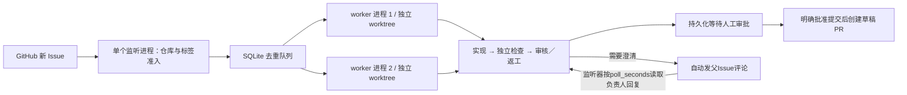

# 常驻 Issue 监听与多任务调度

RepoPilot 使用一个轮询／调度进程和有上限的 worker 进程池。每个 Issue 有独立的运行状态、预算计数和 worktree；人工审批等待保存在 SQLite 中，不占 worker。当前不自动合并或发布软件。



## 接入与启动

先把目标仓库克隆到本机，确认是可信代码，并准备命名检查模板，见 `examples/runtime/github-issue-template.yaml`。仓库路径和检查命令都由本机操作者提供，不能来自 Issue。GitHub 凭证在 `.env` 中，不写进任务或监听配置。

复制 `examples/runtime/watch.example.yaml` 到本机位置，修改 `targets[].task`。该路径相对监听配置文件，任务内部 repository 相对任务文件。配置示例：

```yaml
poll_seconds: 60
poll_comments: true
max_workers: 1
max_per_repository: 1
targets:
  - task: github-demo.yaml
    label: repopilot
    include_existing: false
    settings:
      plan_enabled: true
      issue_comments_enabled: true
      max_implementation_slots: 2
      implementation_slot_timeout_seconds: 30
      thinking: enabled
      reasoning_effort: low
      max_context_bytes: 300000
      max_model_calls: 48
      max_tool_calls: 80
      max_edits: 24
      max_output_tokens: 8192
      request_timeout_seconds: 120
      run_timeout_seconds: 900
      max_run_cost_cny: 8
```

`plan_enabled`和`issue_comments_enabled`默认都是true：新Issue先做任务说明与计划，等待澄清时自动发父Issue评论并轮询回复。`--no-plan`／`REPOPILOT_PLAN_ENABLED=false`或`poll_comments: false`／`REPOPILOT_ISSUE_COMMENTS_ENABLED=false`可以关闭；关闭后仍是原单Agent和本地答复路径。`poll_comments`只控制监听器是否扫描等待批次，不改变单次`human post`／`sync`。并行计划的`max_implementation_slots`是全局共享槽位，默认2；不同Issue和监听worker都不能突破，等待空位超时后停止而不是无限排队。

```powershell
# 当前终端常驻；Ctrl+C 停止接新任务，等待当前 worker 落盘后退出
.\.venv\Scripts\repopilot.exe watch --config .local/watch.yaml
# 轮询一次，处理本轮可运行队列后退出
.\.venv\Scripts\repopilot.exe watch --config .local/watch.yaml --once
# 另一个终端查看心跳／PID／队列，或请求干净停止
.\.venv\Scripts\repopilot.exe watch --status
.\.venv\Scripts\repopilot.exe watch --stop
```

这是应用自己的常驻命令，不是系统服务或开机自启。后台部署时由操作者管理进程和日志。`--stop` 不立即杀死正在执行的检查或模型请求；可能需要等到该任务完成、超时或触限。

`watch --status` 保留外层 `status: ok` 表示查询成功，监听器状态看 `watcher.status`：`running` 表示最近30秒内有心跳，`stale` 表示超过30秒，`stopped` 表示最后记录为正常停止，`not_started` 表示无记录，`unknown` 表示时间非法／明显在未来等无法判断。返回 `recorded_status`、`heartbeat_at`、`age_seconds`、`stale_after_seconds`、`healthy` 与原因；不把陈旧running继续报告为健康，也不改写数据库历史或自动恢复队列。

`healthy`只表示心跳新鲜；`stale`不证明进程已经死亡。轮询API阻塞也可能延迟心跳，需要结合PID、锁、日志及队列核查。任务中断仍由队列的interrupted与运行检查点表示；本增量没有进程身份校验、独立心跳线程或系统服务自恢复。

## 自动接单规则

- 默认只接已登记仓库中、首次激活时间之后创建、带 `repopilot` 标签的开放 Issue；排除 PR 和关闭工单。初次激活时间写 SQLite，重启不会重新设起点而漏掉停机期间的新工单。
- `label: null` 表示该登记仓库的新 Issue 不要求标签。它会扩大自动调用模型的范围，应由操作者明确配置。
- `include_existing: true` 还接已有的开放工单。默认 false 时，给旧 Issue 后补标签不会把旧工单视为新建。
- 使用 Issues REST 分页，不依赖首屏；单轮超过 1,000 条时报错。默认每 60 秒轮询，最小 15 秒；错误指数退避，并遵守 Retry-After／耗尽限流窗口的等待时间。
- 每个 Issue 的队列键唯一；已有运行（含失败、审批中或已交付）不自动重跑。显式 retry 才开启新尝试，保留旧失败和同一累计预算账本。
- worker 再次读取开放 Issue、核对 origin，拉取远端默认分支对象并固定基线；不 checkout／reset 用户原工作树，也不改变用户分支。随后先持久化 run_id 与队列关系，再调用模型。
- 新任务默认先规划；规划、实现或审核需要澄清时保存`needs_input`并自动投递父Issue批次评论。监听器每轮按`poll_seconds`扫描等待中的运行，按剩余worker槽位读取登记负责人回复；有有效答复才恢复任务，没有答复只记录核对时间，不调用模型。
- 成功停在 awaiting_approval，不自动 approve／publish。失败会释放 worker、保留原因，不进入无限重试。

## 并发与恢复

`max_workers` 为全局上限（1–4），`max_per_repository` 为同仓库运行上限（1–4）。默认两个值都是 1。可先把全局设为 2，让不同仓库并行；确认机器资源、检查命令和成本后再提高同仓库并发。评论同步和恢复与 issue worker 共用同一个有界进程池，因此等待回复本身不占槽位，只有真正恢复执行才占；恢复前会把对应队列行临时标为`running`，同样受`max_per_repository`约束，失败时归还原等待状态。单个并行计划的实现worker还受`max_implementation_slots`（全局默认2）限制，与监听worker数是两个独立边界。

worktree 隔离不等于操作系统隔离。两个任务仍共享宿主权限、网络、部分 Git 元数据和本地资源；登记检查必须避免共享可写数据、固定端口和真实账号。源仓库工作树保持不变并不证明没有宿主副作用。

一个输出根目录只允许一个监听器持有全局锁。队列领取在 SQLite 事务中检查同仓库运行数，不能靠重启绕过预算。上次监听退出留下的 running 队列项在重启时标记 interrupted，**不自动回队**；子进程可能已有副作用，甚至仍在运行：只要有 interrupted 队列项，监听器就暂停所有新分派，防止借重启放大并发。先核对 PID、运行锁和 worktree，必要时 recover／resume；确认旧进程结束后可显式 `watch --acknowledge OWNER/REPO#N --reason "已核查旧进程和现场"` 解除队列阻塞。若任务仍记录 running／publishing 则拒绝确认。确认不会自动重跑原工单；原 worker 若自行正常退出，也可把队列更新为其实际终态。队列 status 是 worker 交接时状态，run_status 是对应任务的最新状态。

多工单开发可以并行，但合并需要协调：不同工单可能修改同一文件，独立 PR 不能保证互不冲突。默认分支变化后，旧候选不能直接发布；需更新基线、重新验证和审核，获得新版本批准。CLI 的 GitHub issue／retry 会重新取得远端基线，resume 则保持冻结版本。首版没有自动 rebase、合并队列或自动重试冲突。

## 已验证与限制

已真实验证单监听器、一个独立 worker 自动处理新 Issue 到人审暂停；已用两个真实 spawn 进程、虚构队列验证不同仓库可以同时运行，并用回归验证同仓库限额。它不是两个真实模型工单的并发效果证明。

重启去重、停止入口、故障退避与既有任务不重复接入都有回归／本机验证；没有长期运行、机器重启恢复、网络长时间故障或多主机部署证据。评论自动投递／轮询只有Fake／MockTransport机制和本地队列验证，没有真实GitHub Issue评论往返或平台限流长期运行证据；完整事实见 [验证记录](VALIDATION-05.md)。

接口来源：[GitHub List repository issues](https://docs.github.com/en/rest/issues/issues#list-repository-issues)、[GitHub REST 最佳实践](https://docs.github.com/en/rest/using-the-rest-api/best-practices-for-using-the-rest-api)。
